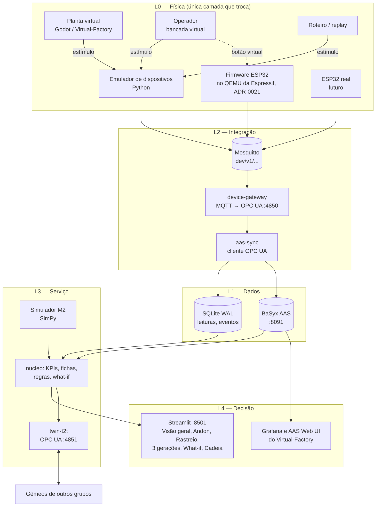
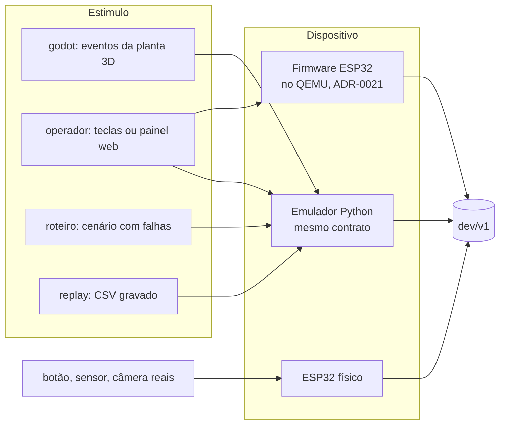

# ARCHITECTURE — Linha de Celulares 4.0 (M3)

Arquitetura-alvo do Módulo 3. Requisitos em [SPECS.md](SPECS.md); justificativas em [docs/adr/](docs/adr/README.md).
Estado: **projeto, nada implementado**. Os pontos marcados "a validar na Fase 0" dependem de rodar o
Virtual-Factory neste ambiente.

## 1. Visão em uma frase

Dispositivos (emulados hoje, ESP32 amanhã) publicam por MQTT num contrato fixo; um gateway converte para OPC UA; um
sincronizador escreve no AAS e no banco de eventos; o gêmeo, o dashboard e a rede federada leem só desses contratos.
O Virtual-Factory fornece a planta virtual 3D, o ambiente AAS e a infraestrutura.

## 2. Camadas L0–L4



| Camada | No M2 (entregue) | No M3 (alvo) | Muda? |
|---|---|---|---|
| L0 | SimPy | Dispositivo que cumpre o contrato `dev/v1`: emulador, firmware em emulador ou ESP32 | Sim, e só ela |
| L2 | MQTT → coletor | MQTT → `device-gateway` → OPC UA → `aas-sync` | Novo, estável a partir da Fase 1 |
| L1 | SQLite `eventos` (tempo simulado) | SQLite `leituras` + `eventos` (tempo real) e AAS | Novo |
| L3 | Painel reproduz eventos | KPIs, fichas, regras, T2T; planta 3D como gêmeo visual | Novo |
| L4 | Streamlit + HTML | Streamlit multipágina com Andon de 4 níveis | Evolução |

A prova que a disciplina cobra ("só a L0 muda") vira um teste: o mesmo commit de L2–L4 roda com qualquer fonte de
estímulo.

## 3. O que vem do Virtual-Factory e o que é nosso

O Virtual-Factory fica **intocado** em `Base/Virtual-Factory` (commit fixado). O M3 é uma camada por cima: um
arquivo compose adicional, serviços próprios e dados próprios (ADR-0001).

| Bloco | Origem | Uso no M3 |
|---|---|---|
| Godot: dispositivos, CLP virtual, peças com QR | Virtual-Factory | Planta virtual que gera estímulo físico (fonte `godot`) e é o gêmeo 3D |
| Mosquitto (1883, 9001) | Virtual-Factory | Mesmo broker; árvore nova `dev/v1/...` ao lado do UNS `vf/...` |
| BaSyx AAS (8091), Web UI (3001), DPP API (8093), resolver (8096) | Virtual-Factory | Destino da escrita do `aas-sync`; ficha navegável por QR |
| `plc-comm` (4840, 4841) e `edge` | Virtual-Factory | Inalterados; servem de referência de servidor OPC UA |
| Historian, Grafana, alarmes, MES, ERP, manutenção, fornecedor | Virtual-Factory | Fora do perfil reduzido (ADR-0016); sobem só com a pilha completa |
| `device-gateway`, `aas-sync`, `twin-t2t` | **Nosso** | Núcleo do M3 |
| Firmware ESP32 e emulador de dispositivos | **Nosso** | L0 |
| `app/` (Streamlit) e `nucleo/` | **Nosso**, herdando cálculos do M2 | L3/L4 |
| Simulador SimPy | M2 (`GemeoDigitalCelulares`) | Geração "Simulado" e what-if |

**Perfil reduzido da base (tarefa 0.5, ADR-0016).** O M3 sobe só 8 dos 27 serviços do compose da base:
`mqtt`, `db`, `basyx-config`, `provisioner`, `aas-env`, `aas-ui`, `plc-comm`, `edge` (6 de longa duração e 2 de
execução única). Nenhum deles depende dos 19 que ficam de fora. Medido em 2026-11-15 a partir de `base/` com os
objetos LFS reais: subida assentada em 66–112 s (duas rodadas), 776,1 MiB somados nos 6 contêineres contra
2 721,1 MiB nos 23 da pilha completa (−71 %); AAS com 27 shells; planta Godot sem janela publicando
`part_released`, `part_inspected` e `part_sorted`. Modo econômico opcional sem `plc-comm` e `edge` (planta com
`--vf-backplane=off`): 402,8 MiB, mas sem o OPC UA 4840 do CLP. Evidência: `docs/evidencias/f0-0.5-perfil-reduzido.md`.

Direção dos fluxos: o Virtual-Factory já leva **CLP → OPC UA → edge → MQTT → bridge → AAS**. O M3 acrescenta o
caminho dos dispositivos de campo no sentido pedido pelo grupo, **dispositivo → MQTT → OPC UA → AAS**, sem alterar o
primeiro (ADR-0004).

## 4. Recorte do cenário e mapeamento da planta

A linha do Cenário 08 tem 22 estações (10 de SMT e 12 de montagem). O M3 instrumenta o **trecho final da montagem**,
onde o M2 localizou o gargalo (ADR-0009). Mapeamento para a planta do Virtual-Factory, validado na Fase 0 com a
planta rodando (evidência `docs/evidencias/f0-0.6-mapeamento.md`):

| Linha de celulares (M2) | Planta virtual | Evento UNS de origem | Dispositivo do M3 |
|---|---|---|---|
| Saída da montagem manual (posto Bateria, gargalo de 27 s) | Célula de montagem AC01 | `ac01/event/part_released` (serial, lotes) | `esp32-bat01`: botão de ciclo; `qr-entrada`: leitura na entrada |
| Teste funcional | Estação de inspeção QS01; evento publicado pelo CLP PLC01 | `plc01/event/part_inspected` (serial, `result` 1 = aprovado, 2 = reprovado) | Resultado aprovado/reprovado |
| Embalagem | Robô RB01 → KLTA01 (aprovadas) / KLTB01 (reprovadas); evento do PLC01 | `plc01/event/part_sorted` (serial, `container` 1/2, `slot`) | `qr-saida`: leitura na saída |
| Forno de refusão (opcional) | — (sem equivalente) | — | `esp32-forno01`: temperatura por roteiro |

A planta libera uma peça a cada 12,000 s fixos (takt do layout da base) e é determinística (sementes fixas): a
mesma sequência de tempos e defeitos se repete a cada execução. Serve para fluxo, rastreio e resultado por peça; o
tempo de ciclo do posto Bateria vem da fonte `operador` (ADR-0013).

## 5. L0 — dispositivos e a costura de hardware



Três níveis de fidelidade, mesmo contrato:

| Nível | O que roda | Para quê | Custo |
|---|---|---|---|
| N1 | Emulador Python (`hardware/emulador/`) | Desenvolvimento, CI, demo e plano B | Zero |
| N2 | O firmware real num emulador de ESP32 | Provar que o código embarcado funciona sem placa | Zero; ferramenta a escolher na Fase 1 |
| N3 | ESP32 físico | Hardware real, se o grupo adquirir | R$ 40–80 |

**Firmware** (`hardware/firmware/`, C++ para ESP32): lógica separada do hardware por uma camada de abstração.
A lógica (debounce, cronometragem do ciclo, montagem do payload, numeração `seq`) não depende de placa e é testável
no PC; só a camada fina de pinos, Wi-Fi e MQTT é específica do ESP32. Pinagem prevista: botão no GPIO 5 com pull-up
interno, DHT22 no GPIO 4, alimentação pela USB.

**Leitor de QR** (`hardware/leitor_qr/`): no modo real, câmera + decodificação no PC, como na aula; no modo emulado,
recebe o conteúdo do QR da fonte de estímulo, ou decodifica imagens de QR geradas, o que exercita o caminho real de
decodificação. Deduplicação e expiração ficam no gateway, não no leitor.

**Regras que valem para qualquer nível:** sem data/hora no dispositivo; `seq` crescente por dispositivo; Last Will
`offline`; reconexão automática; nada de lógica de negócio no dispositivo.

Trocar emulador por hardware: gravar o firmware, configurar broker e identificador, desligar o emulador daquele
dispositivo. Nada acima do broker muda (RF-G-04).

## 6. L2 — integração

### 6.1 `device-gateway` (MQTT → OPC UA)

Equivale ao `gateway.py` e ao `gateway_multi.py` das aulas, com MQTT no lugar da serial.

1. Assina `dev/v1/+/status`, `dev/v1/+/tel/+`, `dev/v1/+/evt/+`.
2. Valida: esquema do payload, tipo, faixa calibrada por canal, sequência (`seq` repetido é descartado; lacuna é
   contada), QR duplicado dentro da janela e peça esquecida há mais de 2 h.
3. Carimba o timestamp (relógio do gateway).
4. Associa ciclo ↔ peça: o ciclo de um posto pertence à última peça lida naquele posto.
5. Escreve no servidor OPC UA `opc.tcp://0.0.0.0:4850/lean/dispositivos`, um objeto por dispositivo declarado em
   `config/dispositivos.yaml`.
6. Mantém `Online` e `UltimaLeitura` por objeto: base do Andon cinza.
7. Registra a origem declarada no status de cada dispositivo por sessão de coleta; nenhuma regra depende dela.

Endereços: `ns=2;s=LinhaCelulares.Bateria_01.TempoCiclo`, `...Bateria_01.PecasFeitas`, `...Bateria_01.Online`,
`...Rastreio.UltimaPeca`, `...Rastreio.LeadTimeReal`. Um evento OPC UA por evento de peça (peça, estação, evento,
valor). Dado rejeitado vai para um contador e um log, nunca para o banco.

Canal das rejeições até o `aas-sync` (ADR-0019, Proposto): `LinhaCelulares.Gateway.UltimaRejeicao` (JSON numerado
por `n`) e contadores `Rejeitados`, `Duplicatas`, `Lacunas` por objeto; o `aas-sync` assina e grava `rejeitados`.
Cada objeto também expõe `Origem`, `Boot` e `Firmware` (para `sessoes`) e `UltimoEvento`. Sequência: a base zera
só com boot novo, ou com `up_ms` que recomeçou logo após um status online do mesmo boot (reinício sem incremento);
tel/evt de boot anterior é rejeitado. Código e variáveis: `pipeline/device_gateway/README.md`.

### 6.2 `aas-sync` (OPC UA → AAS e banco)

Cliente OPC UA com subscription e reconexão. Para cada mudança:

- grava `leituras` (medidas) e `eventos` (por peça) no SQLite;
- atualiza no BaSyx o estado do dispositivo e a ficha da peça.

É o único processo que escreve no banco e no AAS: uma fila de escrita, sem disputa de lock.

Implementação (tarefa 1.4, ADR-0020, Proposto): assina todas as variáveis dos objetos declarados e do objeto
`Gateway` com `StatusValueTimestamp`; variável Double → `leituras` (`node` = `LinhaCelulares.<Objeto>.<Variavel>`,
`ts` = `SourceTimestamp`); `Gateway.UltimaRejeicao` → `rejeitados`; `Online`/`Origem` → `sessoes`. Índices únicos
tornam o reinício idempotente. No AAS, shell `urn:lean-manufacture:grupo7:aas:<id>` e submodelo
`DadosOperacionais`, atualizados a cada `AAS_INTERVALO_S`. `eventos` só recebe linhas a partir da 2.3/2.4. Falha
transitória do SQLite repete o lote com backoff; erro permanente põe o lote em quarentena
(`dados/estado/aas-sync/lotes-falhos.jsonl`); contadores `falhas_banco` e `lotes_em_quarentena` no arquivo de saúde.
Código: `pipeline/aas_sync/README.md`.

## 7. L1 — dados

| Armazenamento | Conteúdo | Quem escreve | Quem lê |
|---|---|---|---|
| SQLite `dados/dados.db` (WAL) | `leituras(ts, node, valor)`, `eventos(ts, peca, estacao, evento, valor)`, `sessoes`, `rejeitados` | `aas-sync` | `nucleo` |
| BaSyx AAS | Estado atual por dispositivo; ficha de rastreabilidade por peça | `aas-sync` | Web UI, resolver por QR, Godot, `nucleo` |
| SQLite do M2 (`processo.sqlite3`) | Históricos simulados validados | Simulador M2 | `nucleo` (geração "Simulado") |

Divisão de papéis (ADR-0007): o banco guarda a **série** que alimenta KPIs; o AAS guarda o **estado e a identidade**
de cada ativo e de cada peça, com semântica padronizada.

Lead time individual: `MAX(ts) − MIN(ts)` por peça em `eventos`. Espera = lead time − soma dos tempos de
processamento registrados.

## 8. L3 — serviço

- **`nucleo/`**: única porta de leitura dos dados (`dados.py`), cálculo de KPIs, fichas, `regras.py` (baseline e
  metas do M1, limites do Andon) e what-if. Nenhuma página faz SQL direto.
- **Gêmeo**: planta 3D do Virtual-Factory (clique na peça abre o AAS dela) + representação 2D no dashboard.
- **`twin-t2t`**: servidor OPC UA `opc.tcp://0.0.0.0:4851`, objeto `EstadoGemeo` com `RitmoReal` (peças com evento
  de saída nos últimos 10 min × 6), `UltimaPeca`, `LeadTimeMedio`, `StatusLinha`. Cliente com reconexão para ler os
  elos vizinhos; elo fora do ar vira `OFFLINE`.
- **Cadeia** (padrão das aulas Extras): fornecedor → **produção (nós)** → distribuição. Lemos o estoque do
  fornecedor e o usamos numa decisão nossa; publicamos também `RitmoProducao` e `StatusLinha`, nomes combinados na
  turma. Lead time da cadeia = soma dos lead times médios locais. Sem parceiros, elos emulados de fornecedor e
  distribuição rodam localmente (ADR-0011).
- **Coordenador** (opcional, Extra 3): lê todos os elos, re-simula cenários da cadeia e publica
  `Recomendacao.MelhorCenario` e `LeadTimeProjetado`; sugere, não comanda.

## 9. L4 — decisão

Streamlit multipágina (ADR-0010):

| Página | Responde |
|---|---|
| Visão geral | Como estamos agora? KPIs contra baseline e meta, layout com estados |
| Andon | Tem algo errado? Verde, amarelo, vermelho e **cinza** (sem dado novo ou dispositivo offline) |
| Rastreio | Ficha da peça por ID ou QR: trajetória, tempos, espera, comparação com a média |
| 3 gerações | Baseline M1 × simulado M2 × medido M3 × meta, com as divergências |
| Dispositivos | Online/offline, última leitura, rejeições por faixa, lacunas de sequência |
| What-if | Reaproveita o simulador do M2 |
| Cadeia | Elos, ritmo, lead time da cadeia, propagação |

Grafana e a AAS Web UI do Virtual-Factory continuam disponíveis como visão de engenharia.

## 10. Execução e implantação

| Processo | Porta | Onde roda |
|---|---|---|
| Mosquitto | 1883, 9001 | Contêiner (Virtual-Factory) — confirmado na Fase 0 |
| BaSyx AAS / Web UI | 8091 / 3001 | Contêiner (Virtual-Factory) — confirmado na Fase 0 (`/shells` com 27; UI 200) |
| `plc-comm` (CLP virtual) | 4840, 4841 | Contêiner (Virtual-Factory) — confirmado na Fase 0 (TCP; `edge` ponteia `opc.tcp://localhost:4840/vf/plc01`) |
| `edge` (CLP → UNS) | — | Contêiner (Virtual-Factory), no perfil reduzido |
| Postgres do BaSyx (`db`) | 5432 (só interno) | Contêiner (Virtual-Factory), no perfil reduzido |
| `device-gateway` | 4850 (`/lean/dispositivos`) | Contêiner `lean-m3-servicos:dev` (compose adicional); healthcheck lê `ServerState` no próprio OPC UA — Fase 1 |
| `aas-sync` | — | Mesma imagem; healthcheck por sinal de vida (`SAUDE_PATH`); banco em `dados/` montado em `/dados` — Fase 1 |
| `twin-t2t` | 4851 | Contêiner (Fase 3, não existe ainda) |
| Emulador de dispositivos / firmware no QEMU | — | Processo local iniciado pelo `start.py` |
| Streamlit | 8501 | Processo local iniciado pelo `start.py`; lê o mesmo `dados/dados.db` em WAL |
| Godot (planta 3D) | — | Nativo no host, sem janela, iniciado pelo `start.py --fonte godot` |

Na Fase 0 (2026-11-15) as portas 1883, 9001, 4840, 4841, 4850, 4851, 8091, 3001 e 8501 estavam livres no host antes
da subida (`f0-0.2-ambiente.md`). Não houve sessão OPC UA com cliente na 4840: só abertura TCP e o `edge` conectado.
Perfil reduzido por `profiles` (tarefa 1.6, ADR-0022, que complementa o item 2 do ADR-0016): o
`infra/docker-compose.lean.yml` põe os 19 serviços da base fora do perfil A no profile `base-completa`; sem
`--profile`, `docker compose -f base/infra/docker-compose.yml -f infra/docker-compose.lean.yml up` sobe só os 8 da
base e os 2 do M3. Com vários `-f`, os caminhos relativos partem de `base/infra`, por isso o override usa `../..`.
Dentro da rede do compose os serviços usam `mqtt`, `aas-env` e `device-gateway` como endereço; fora, os padrões
`localhost` (variáveis de ambiente). Detalhes: `infra/README.md`.

Subida: `python3 start.py --fonte <roteiro|godot|operador|firmware|hardware>` (ADR-0012) sobe o compose do
Virtual-Factory com o nosso arquivo adicional, espera os health checks (broker, AAS, gateway, porta 4850, aas-sync),
inicia o dashboard e a fonte escolhida e passa a monitorar a cada 5 s: processo vivo (reinicia o dashboard até 3
vezes), porta respondendo e dado fluindo. Ctrl+C derruba o que a execução subiu; `--manter-base` deixa a base no
ar; `--parar` faz `compose down` sem `-v`. A fonte `replay` ainda não existe e o `start.py` não a oferece. Medido na 1.6: health checks verdes
em 59,6 s a frio (`docs/evidencias/f1-1.6-start.md`).

Contêiner de desenvolvimento (tarefa 1.0, ADR-0015 e ADR-0024): `.devcontainer/` com as ferramentas fixadas, rede
`--network=host` e o Docker do hospedeiro pelo socket.

Estrutura-alvo do repositório final (a aula 4 a prescreve):

```text
lean-manufacture/                (github.com/vitorramon/lean-manufacture; local: Documentation/Atividade/MOD 3)
  README.md  SPECS.md  ARCHITECTURE.md  PLAN.md  PROGRESS.md  CLAUDE.md
  start.py
  docs/        adr/  relatorio.pdf  arquitetura.png  cartoes_conexao.md  evidencias/
  hardware/    firmware/  emulador/  calibracao/  leitor_qr/ (Fase 2)  dispositivos.md (componentes, pinagem, custo)
  pipeline/    device_gateway/  aas_sync/  contrato/ (esquemas e mensagens de referência)
  twin/        t2t/  cadeia/
  app/         Home.py  pages/  nucleo/
  simulador/   (M2: GemeoDigitalCelulares)
  base/        (Virtual-Factory, commit fixado)
  infra/       docker-compose.lean.yml  lean-servicos.Dockerfile  orquestracao.py
  config/      dispositivos.yaml  origens.yaml
  dados/       amostras/  analises/  etiquetas/
  tests/
```

## 11. Qualidade e verificação

- **Testes de contrato**: esquemas JSON e mensagens de referência em `pipeline/contrato/`, validados contra o
  emulador, o construtor de payload do firmware e o gateway. É o que garante que emulador e ESP32 são
  intercambiáveis.
- **Testes do gateway**: faixa, duplicata, lacuna, QR repetido, peça expirada, linha malformada.
- **Testes de KPI**: lead time, espera e ritmo sobre conjuntos pequenos com resultado conhecido.
- **Testes de falha**: derrubar dispositivo, broker, gateway e elo vizinho; o sistema pausa e se recupera.
- **Evidências**: cada item da rubrica aponta para um arquivo em `docs/evidencias/`.

## 12. Limitações conhecidas do projeto

| Limitação | Impacto | Proposta |
|---|---|---|
| L0 emulada (firmware no QEMU desde a 1.8, com Ethernet no lugar do Wi-Fi) | Sem ruído elétrico, alimentação instável, Wi-Fi ou cabo real | ESP32 físico quando disponível (tarefa 5.6) |
| Planta 3D é de cilindros pneumáticos | Tempos da planta virtual não são os da linha de celulares | Mapeamento explícito; fonte `operador` para tempos humanos |
| Recorte de 3 pontos em 22 estações | Lead time medido é do trecho, não da linha | Comparar com o mesmo trecho do simulado |
| Calibração contra modelo, não contra instrumento | Erro de sensor é o que o emulador injeta | Declarar como calibração de procedimento |
