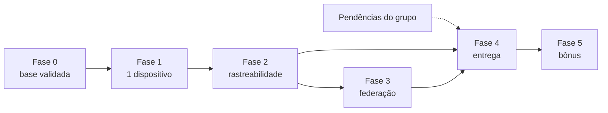

# PLAN — Módulo 3

Ordem de execução para cumprir [SPECS.md](SPECS.md) com a arquitetura de [ARCHITECTURE.md](ARCHITECTURE.md).
O andamento fica em [PROGRESS.md](PROGRESS.md). Cada fase termina com algo que roda e com as evidências que a aula
correspondente exige.

Princípios: fatia vertical primeiro (um dado atravessando tudo antes de alargar); contrato antes de código;
evidência coletada no momento em que a funcionalidade passa, não na véspera; bônus por último.

## Antes de começar: pendências do grupo

Não dependem de código e destravam decisões. Detalhes em SPECS §9.

- [x] P-01 Recuperar a entrega do M1 e anotar baseline, metas e Mudas (2026-11-15, SPECS §2.1)
- [ ] P-02 Perguntar ao professor sobre L0 totalmente emulada
- [x] P-03 Extras: material lido; o grupo confirmou que não as fez (2026-11-15) — conteúdo absorvido na Fase 3
- [ ] P-04 Definir grupo parceiro da cadeia (ou assumir elo emulado)
- [ ] P-05 Datas de apresentação e entrega; integrantes e papéis
- [x] P-06 Criar fork do Virtual-Factory e repositório final no GitHub — 2026-11-15: fork
      `vitorramon/Virtual-Factory` (ADR-0014) e repositório `vitorramon/lean-manufacture` (remoto `origin`)
- [ ] P-07 Decidir se haverá meta de lead time/espera (o M1 não definiu)

## Fase 0 — Fundação e validação da base

Objetivo: saber se o Virtual-Factory roda neste ambiente (Linux/WSL2 com Docker Desktop) e quanto dele é preciso.

- [x] 0.1 Iniciar o repositório Git do M3; incluir Virtual-Factory e simulador do M2 com commit fixado (ADR-0001)
- [x] 0.2 Instalar ferramentas: `uv`, Python 3.12, Godot 4.7.2, Git LFS, navegador OPC UA (UaExpert ou equivalente)
- [x] 0.3 Subir o compose do Virtual-Factory e registrar o que sobe, tempo de subida e consumo de memória
- [x] 0.4 Rodar a planta em modo sem janela e observar os eventos `part_released`, `part_inspected`, `part_sorted`
- [x] 0.5 Definir o perfil reduzido de serviços necessário ao M3
- [x] 0.6 Validar o mapeamento planta virtual ↔ linha de celulares (ARCHITECTURE §4) e ajustar o ADR-0009
- [x] 0.7 Rodar o simulador do M2 em Linux, conferir os números de SPECS §2.2 e extrair FPY, RTY e COPQ do painel
- [x] 0.8 Rodar 30 replicações do M2 (sementes distintas) no trecho recortado: média ± desvio da geração "Simulado"

Saída: registro em PROGRESS com medições; ADR-0009 confirmado ou revisado; decisão de continuar com a base.
Ponto de decisão: se a base não subir de forma estável em WSL2, reabrir o ADR-0001 antes de escrever código.

## Fase 1 — Primeiro dispositivo de ponta a ponta (Aula 1)

Objetivo: um evento de ciclo sai de um dispositivo emulado e aparece no dashboard, passando por MQTT, OPC UA, banco
e AAS.

- [ ] 1.0 Contêiner de desenvolvimento (`.devcontainer/`, ADR-0015): Python 3.12/uv, Godot 4.7.2, git-lfs, amqtt,
      asyncua, PlatformIO, Node; Docker do hospedeiro; validar rede até broker e OPC UA e rodar a planta sem janela
      — parcial em 2026-11-15: falta executar `devcontainer up` ou "Reopen in Container" e anexar a saída
- [ ] 1.1 Escrever o contrato `dev/v1`: esquemas JSON e mensagens de referência (`pipeline/contrato/`)
      — parcial em 2026-11-15: falta `.env.example`; alinhar `origem` (ADR-0005, regra firmware.md); decidir `boot` obrigatório
- [ ] 1.2 Emulador Python do `esp32-bat01` com a fonte `roteiro`
      — parcial em 2026-11-15: falta reexecutar a integração com o broker no ar (fonte roteiro rodou pelo `start.py` na 1.10)
- [ ] 1.3 `device-gateway`: assinatura MQTT, validação, timestamp, servidor OPC UA com um objeto
      — parcial em 2026-11-15: falta corrigir a sequência (zerar só com boot novo, rejeitar boot menor), ruff no dev, print do address space no UaExpert
- [ ] 1.4 `aas-sync`: subscription OPC UA → `leituras` no SQLite e estado do dispositivo no AAS
      — parcial em 2026-11-15: falta repetir a gravação no SQLite com backoff (hoje descarta o lote) e reexecutar integração e queda
- [ ] 1.5 `nucleo/dados.py` e página "Visão geral" mínima; Andon cinza por ausência de dado
      — parcial em 2026-11-15: falta o vídeo do RF-A1-10; origens medidas fixas na L3; sessão de teste do operador aparece como medida
- [ ] 1.6 Compose adicional e `start.py` com health check
      — parcial em 2026-11-15: falta teste em máquina limpa (RNF-01) e exercitar `operador` com pessoa
- [ ] 1.7 Firmware ESP32: lógica independente de placa, camada de hardware, publicação MQTT; compilar para ESP32
      — parcial em 2026-11-15: evidência com tamanho de binário errado (real: Flash 761 933 B, RAM 45 328 B); `eventosPerdidos` não publicado
- [x] 1.8 Escolher e configurar o emulador de firmware; rodar o firmware nele contra o mesmo broker
      — 2026-11-15: QEMU da Espressif (ADR-0021), 16/16 mensagens válidas com `firmware:emulado`
- [ ] 1.9 Fontes `godot` e `operador` no emulador
      — parcial em 2026-11-15: operador só com teclas injetadas; desde 2026-11-16 a sessão de teste se declara `emulador:teste` (ADR-0025)
- [ ] 1.10 Teste da troca de L0: mesmo commit de L2–L4 com `roteiro`, `godot`, `operador` e firmware emulado
      — parcial em 2026-11-15: 4 fontes com o mesmo hash de L2–L4; falta commit de L2–L4 e fonte `hardware`; sessão de teste fora da amostra medida desde 2026-11-16 (ADR-0025)
- [ ] 1.11 Procedimento de calibração (4 testes) e faixas de validação; registro no README
      — parcial em 2026-11-15: 4 testes só sobre emulação; calibração física pendente
- [ ] 1.12 Coleta de ≥ 30 ciclos com a fonte `operador`; comparação com o simulado (tabela e histogramas)
      — bloqueado em 2026-11-15: falta a sessão com pessoa (≥ 30 ciclos); scripts prontos
- [ ] 1.13 Classificação de ≥ 3 outliers (Muda real × falha de medição)
      — bloqueado em 2026-11-15: depende da 1.12

Evidências: print do address space; vídeo do dashboard atualizando; gráfico comparativo; registro de calibração;
tabela de outliers.

## Fase 2 — Vários dispositivos e rastreabilidade (Aula 2)

Objetivo: cada peça tem identidade, trajetória e lead time próprios.

- [ ] 2.1 Segundo e terceiro dispositivos por configuração (`qr-entrada`, `qr-saida`); nenhum código de L2–L4 muda
      — parcial em 2026-11-16: falta print do address space (UaExpert ou equivalente) com `QR_Entrada`, `QR_Teste`,
      `QR_Saida`, `Bateria_01` e `Rastreio`; ADR-0008 e ADR-0026 Propostos
- [ ] 2.2 Leitor de QR: modo emulado e modo câmera; geração das etiquetas
      — parcial em 2026-11-16: falta teste com webcam real e etiquetas impressas (≥ 2 cm conferidos); reexecutar as
      integrações do emulador com o broker no ar
- [ ] 2.3 Tabela `eventos`; deduplicação e expiração de peças no gateway
      — parcial em 2026-11-16: falta rodar as integrações com o broker no ar; entrada duplicada depois de reinício
      do gateway só declarada (convenções §3)
- [ ] 2.4 Associação ciclo ↔ peça por posto
      — parcial em 2026-11-16 (junto com a 2.3): 31/31 ciclos associados no banco da 2.8; falta integração com broker
- [ ] 2.5 Ficha da peça no AAS e ligação com o QR da peça da planta virtual (ADR-0008)
      — parcial em 2026-11-16: falta abrir a ficha e o AAS `WP_` com `--profile base-completa`; rodar integrações e
      `test_carga` com broker e AAS no ar; ADR-0026/0027 Propostos
- [ ] 2.6 Página "Rastreio": busca por ID, trajetória, espera, comparação com a média
      — parcial em 2026-11-16: falta print novo pelo `start.py` depois da correção da revisão
- [ ] 2.7 Página "Dispositivos": online, última leitura, rejeições, lacunas
      — parcial em 2026-11-16: falta print novo pelo `start.py` depois da correção da revisão
- [ ] 2.8 Fluir ≥ 20 peças; fichas de ≥ 3 peças (uma rápida, uma lenta)
      — parcial em 2026-11-16: falta vídeo de uma peça atravessando a linha, ficha de peça lenta de verdade
      (operador ou roteiro com espera), prints refeitos e ligação com o AAS `WP_` no perfil completo
- [ ] 2.9 Análise de espera: peça mais lenta, onde esperou, Muda do M1 associada
      — parcial em 2026-11-16: falta reescrever o texto com os números corrigidos, repetir com fonte `operador`
      (Muda real) e comparar o valor com o M2 no mesmo trecho
- [ ] 2.10 Resultado do teste por peça nos eventos; FPY e RTY medidos no trecho
      — parcial em 2026-11-16: FPY = RTY de demonstração 90,3 % (28/31, `emulador:godot`), não medição; falta
      fonte com resultado real e vídeo

Evidências: print do address space com ≥ 2 objetos; vídeo de uma peça atravessando a linha; três fichas; consulta
mostrando ausência de eventos repetidos.

## Fase 3 — Rede federada (Aula 3)

Objetivo: o estado medido sai do gêmeo, um vizinho reage, e a cadeia tem lead time.

- [ ] 3.0 Modelo simplificado da cadeia (fornecedor → produção → distribuição) em SimPy: lead time simulado da
      cadeia, que substitui o resultado da Extra 2 não realizada
- [ ] 3.1 `twin-t2t`: servidor com `RitmoReal`, `UltimaPeca`, `LeadTimeMedio`, `StatusLinha`
- [ ] 3.2 Cliente com reconexão automática e estado `OFFLINE` por elo
- [ ] 3.3 Elos "Fornecedor" e "Distribuição" emulados localmente; teste em `localhost` antes de qualquer rede
- [ ] 3.3a Usar o dado do vizinho numa decisão nossa (ex.: estoque do fornecedor baixo → `StatusLinha`)
- [ ] 3.3b Contrato de interface da cadeia e cartão de conexão completo (tipos e unidades)
- [ ] 3.4 Página "Cadeia": elos, ritmo, lead time da cadeia (soma dos locais)
- [ ] 3.5 Teste de propagação: interromper a produção e medir o tempo de reação do elo a jusante
- [ ] 3.6 Conexão com grupos parceiros, se houver (P-04), na ordem `localhost` → `ping` → porta → OPC UA
- [ ] 3.7 Tabela das 3 gerações do lead time da cadeia
- [ ] 3.8 Registro de falhas provocadas e da recuperação

Evidências: vídeo da propagação com o tempo medido; painel da cadeia; `docs/cartoes_conexao.md`; registro de falhas.

## Fase 4 — Consolidação e entrega (Aula 4)

Objetivo: um produto único, documentado e reproduzível.

- [ ] 4.1 Página "3 gerações" com a tabela final e as divergências
- [ ] 4.2 Limites do Andon ligados a `regras.py` com baseline e metas do M1 (SPECS §2.1)
- [ ] 4.3 Página "What-if" reaproveitando o simulador do M2
- [ ] 4.4 README final com as 7 seções obrigatórias
- [ ] 4.5 `docs/arquitetura.png`
- [ ] 4.6 Relatório final: 3 gerações, divergências, evidências, limitações (limitação → impacto → proposta)
- [ ] 4.7 Teste do terceiro em máquina limpa; corrigir o README até passar
- [ ] 4.8 Vídeo de reserva de 3 min; link no README
- [ ] 4.9 Slides no roteiro de 15 min; ensaio cronometrado com todos os integrantes
- [ ] 4.10 Checklist de autoavaliação da rubrica; revisão de "frases proibidas"
- [ ] 4.11 Entrega: GitHub + PDF no ambiente da disciplina

## Fase 5 — Bônus e extras (só se sobrar tempo)

- [ ] 5.1 Ishikawa (6M) preenchido com os outliers medidos
- [ ] 5.2 Gêmeo coordenador (Extra 3): ≥ 3 cenários da cadeia com parâmetros medidos, recomendação publicada
- [ ] 5.2a Experimento do efeito chicote (demanda ±20 %)
- [ ] 5.3 Federação ao vivo com outro grupo
- [ ] 5.4 Dispositivo `esp32-forno01` (temperatura) com Andon por faixa
- [ ] 5.5 Adaptação dos dados de produto do AAS para celular; ajustes visuais na planta 3D
- [ ] 5.6 ESP32 físico substituindo um emulador (a demonstração mais forte da costura de hardware)

## Dependências entre fases

A Fase 4 pode começar em paralelo à Fase 3: README, diagrama e relatório crescem desde a Fase 1.

## Caminho mínimo se o prazo apertar

Na ordem em que se corta: Fase 5 inteira → 3.6 (parceiro real; fica o elo emulado) → 1.8 (firmware em emulador;
fica o firmware compilável) → 4.3 (what-if; fica o painel do M2). Não se corta: contrato e teste da troca de L0,
rastreabilidade com fichas, tabela das 3 gerações, README testado por terceiro e vídeo de reserva.

## Definição de pronto

Uma tarefa só é marcada em PROGRESS quando: roda a partir do `start.py`; tem teste automatizado ou roteiro de
verificação manual escrito; a evidência está em `docs/evidencias/`; e a documentação afetada foi atualizada.
