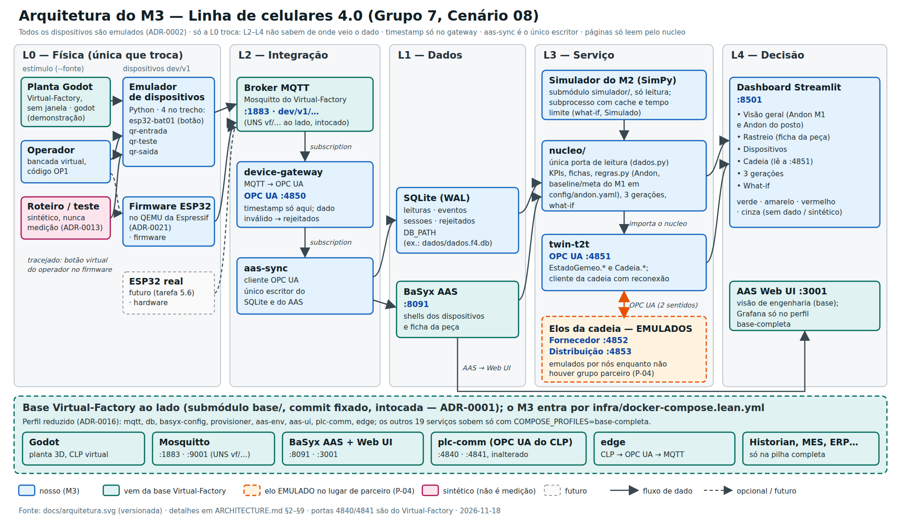

# Linha de Celulares 4.0 — Módulo 3 (Grupo 7, Cenário 08)

Projeto final da disciplina PGENE586 — Lean Manufacturing e Qualidade Aplicadas à Indústria 4.0 (PPGEE/UFAM).

> **Estado em 2026-11-18.** O caminho dispositivo → MQTT → OPC UA → SQLite e AAS → gêmeo T2T → dashboard roda pelo
> `start.py`. As 6 páginas abrem sem erro, e numa rodada de 16,7 min o monitor fez 172 verificações, todas OK
> ([`f4-integracao.md`](docs/evidencias/f4-integracao.md)).
> **Tudo é emulado** (ADR-0002): nenhum número deste README é medição física. A planta `godot` é determinística e
> serve de demonstração, não de medição (ADR-0013). Fornecedor e Distribuição são elos **EMULADOS** pelo próprio
> grupo (P-04). O que só o grupo pode fazer está em [docs/pendencias-do-grupo.md](docs/pendencias-do-grupo.md): coleta
> com operador, vídeos, prints do UaExpert e teste do terceiro.
>
> - Relatório final: [docs/relatorio.pdf](docs/relatorio.pdf) (fonte em [docs/relatorio.md](docs/relatorio.md))
> - Vídeo de reserva (3 min): **pendente (grupo)**, roteiro em
>   [docs/apresentacao/roteiro-video-reserva.md](docs/apresentacao/roteiro-video-reserva.md)
> - Andamento: [PROGRESS.md](PROGRESS.md)

## 1. Cenário

Linha de montagem de celulares no Polo Industrial de Manaus (Cenário 08). Primeiro vem a SMT: impressora de pasta,
SPI, cinco Pick & Place, forno de refusão e AOI. Depois vêm 12 estações de montagem manual, o teste funcional e a
embalagem.

O diagnóstico do M1 apontou dois problemas ligados:

- defeitos de solda em 2 % das placas, detectados só no teste final, depois de consumir componentes caros;
- 12 operadoras montando sem método padronizado.

A meta SMART era zerar o avanço de placas defeituosas para o acabamento e padronizar as 12 estações em 90 dias. Em
números, FPY de 78 para 92 %, RTY de 82 para 90 %, OEE de 68 para 80 % e 1 − COPQ de 95 para 98 % (SPECS §2.1). O M2
simulou a linha com a proposta (SPI e AOI na origem, trabalho padronizado) e mostrou o gargalo no posto Bateria: 27 s
contra um takt de 20 s.

O M3 leva a simulação para a camada física. Dispositivos medem o ciclo do posto Bateria e seguem cada peça por QR Code
no trecho Bateria → Teste → Embalagem (recorte do ADR-0009). Aqui os dispositivos são **emulados**, com a mesma
interface que um ESP32 real usaria, para que a troca por hardware seja só configuração.

## 2. Arquitetura

O dado segue este caminho: dispositivo → MQTT → gateway → OPC UA → AAS e banco de eventos → gêmeo T2T, dashboard e
rede federada. A base é o [Virtual-Factory](https://github.com/aaronzi/Virtual-Factory) (planta 3D em Godot, AAS em
Eclipse BaSyx, MQTT), mantido intocado (ADR-0001). O M3 é uma camada por cima, num compose adicional.



O diagrama é gerado de `docs/arquitetura.svg` por `docs/arquitetura_png.py`
([`f4-4.5-arquitetura.md`](docs/evidencias/f4-4.5-arquitetura.md)). Detalhes em [ARCHITECTURE.md](ARCHITECTURE.md);
decisões em [docs/adr/](docs/adr/README.md) (33 ADRs; 0031–0033 Propostos na Fase 4).

| Camada | Tecnologia | Porta |
|---|---|---|
| L4 — Decisão | Streamlit: Visão geral (Andon), Rastreio, Dispositivos, Cadeia, 3 gerações, What-if | 8501 |
| L3 — Serviço | `app/nucleo` (KPIs, fichas, 3 gerações, what-if com o simulador do M2); `twin-t2t` (OPC UA); elos EMULADOS | 4851; 4852/4853 |
| L2 — Integração | Mosquitto (MQTT, da base), `device-gateway` (MQTT → OPC UA, timestamp só aqui), `aas-sync` (único escritor) | 1883; 4850 |
| L1 — Dados | SQLite em modo WAL (`leituras`, `eventos`, `sessoes`, `rejeitados`) e Eclipse BaSyx (AAS) | arquivo; 8091 |
| L0 — Física | Emulador de dispositivos (fontes `roteiro`, `godot`, `operador`), firmware ESP32 no QEMU, ou ESP32 real | — |

## 3. Como rodar

A subida pelo `start.py` (3.2 e 3.3) foi executada no computador do grupo (WSL2 6.18, Docker Desktop 29.9, 12 CPUs,
15 GiB); os blocos 3.4 e 3.5 (verificação, análises e testes) foram executados à parte. Cada bloco aponta a sua
evidência e a data. **Nada foi testado em máquina limpa** (teste do terceiro, tarefa 4.7, pendência do grupo). O
`.env.example` ainda não existe (a escrita foi negada pela permissão do ambiente; pendência do usuário): as variáveis
estão documentadas nos READMEs citados em 3.3.

**Pré-requisitos:**

- Docker com Compose v2 e git com git-lfs;
- [`uv`](https://docs.astral.sh/uv/), que traz o Python 3.12 (o `start.py` só usa a biblioteca padrão);
- para a fonte `godot`, Godot 4.7.2 (`godot` no PATH ou `GODOT_BIN`);
- para a fonte `firmware`, PlatformIO 6.x e o QEMU da Espressif (`hardware/firmware/emular.sh --instalar`).

O contêiner de desenvolvimento em [`.devcontainer/`](.devcontainer/README.md) traz todas essas ferramentas. Ele foi
validado com `docker run`, não pelo "Reopen in Container".

### 3.1 Clonar

```bash
git clone --recurse-submodules https://github.com/vitorramon/lean-manufacture.git
cd lean-manufacture
git -C base lfs pull          # sem os objetos LFS a base não sobe (f0-0.1-repositorio.md, f0-0.3-subida-base.md)
```

### 3.2 Demonstração completa (a da apresentação)

```bash
COMPOSE_PROFILES=base-completa DB_PATH=dados/dados.demo.db python3 start.py --fonte godot --manter-base
# abrir http://localhost:8501 — páginas na barra lateral
# outro terminal, para encerrar tudo (também encerra o start.py em execução):
COMPOSE_PROFILES=base-completa DB_PATH=dados/dados.demo.db python3 start.py --parar
```

O `start.py` faz o seguinte:

1. sobe a base e os serviços do M3 (`device-gateway` na 4850, `aas-sync`, `twin-t2t` na 4851);
2. espera a saúde de cada um;
3. inicia o dashboard, a planta, a fonte e os elos EMULADOS (4852/4853);
4. monitora processo, porta e dado a cada 5 s.

Ctrl+C derruba o que ele subiu. Na rodada de 2026-11-18 a pilha ficou saudável em 83,4 s, com 26 contêineres
([`f4-integracao.md`](docs/evidencias/f4-integracao.md)). O lead time da cadeia só fica completo (3 de 3 elos)
depois da primeira reposição do Fornecedor emulado, cerca de 15 min depois da subida.

`DB_PATH` escolhe o banco, sempre dentro de `dados/`. Um nome novo cria um banco novo, ou seja, uma rodada limpa.
`dados/dados.demo.db` é só um nome livre para `DB_PATH`: o comando com esse nome **não** foi executado; a rodada da
evidência é o mesmo comando com `dados/dados.f4.db`.

### 3.3 Outras fontes da L0 (mesmo L2–L4; tarefa 1.10, [`f1-1.10-troca-l0.md`](docs/evidencias/f1-1.10-troca-l0.md))

| Fonte | Comando | O que é |
|---|---|---|
| `roteiro` | `python3 start.py --fonte roteiro --velocidade 4` | Tempos escritos à mão: **sintético**, nunca Medido (`f1-1.6-start.md`) |
| `godot` | `python3 start.py --fonte godot --manter-base` | Planta 3D sem janela, ciclos fixos de 12 s: **demonstração** |
| `operador` | `python3 start.py --fonte operador --operador OP1 --manter-base` | Enter = início/fim; a única fonte válida para tempo de ciclo (operador por código, nunca por nome). Testado só com teclas injetadas (`f1-1.10`); sessão com pessoa pendente (1.12) |
| `firmware` | `python3 start.py --fonte firmware --estimulo bancada/demo.txt --manter-base` | Firmware real do ESP32 no QEMU (ADR-0021) |

A fonte `hardware` (ESP32 físico) existe no `start.py`, mas não foi testada, porque não há placa (ADR-0002). As
origens que contam como "Medido (M3)" estão em [`config/origens.yaml`](config/origens.yaml) (ADR-0025). Os limites
do Andon estão em [`config/andon.yaml`](config/andon.yaml). As variáveis de ambiente estão em
[pipeline/contrato/README.md](pipeline/contrato/README.md#variáveis-de-ambiente) e em [app/README.md](app/README.md).

### 3.4 Com a pilha no ar: leituras e roteiros de verificação

```bash
twin/t2t/.venv/bin/uals -u opc.tcp://localhost:4851 -n 'ns=2;s=EstadoGemeo' -l 1      # f3-3.1-twin-t2t.md
twin/t2t/.venv/bin/uaread -u opc.tcp://localhost:4851 -n 'ns=2;s=EstadoGemeo.StatusLinha'
twin/t2t/.venv/bin/python tests/vivo/f3_propagacao.py 6 <saida.log>     # reação da Distribuição (3.5)
twin/cadeia/.venv/bin/python -m cadeia.diagnostico --host localhost --porta 4852 --elo Fornecedor   # 3.6
```

### 3.5 Análises e testes (sem a pilha)

```bash
~/.local/bin/uv run dados/analises/f2_espera.py --db dados/dados.f2.db   # análise de espera (2.9)
~/.local/bin/uv run dados/analises/f3_cadeia_simpy.py                    # modelo SimPy da cadeia (3.0)
~/.local/bin/uv run dados/analises/f3_tres_geracoes.py --logs            # 3 gerações do lead time da cadeia (3.7)
uv run --no-project --python 3.12 --with markdown==3.7 --with playwright==1.65.2 python docs/relatorio_pdf.py   # relatório em PDF
```

Testes automáticos, sem rede externa (os de integração são pulados se o broker local não estiver no ar). Contagens
de 2026-11-18, com a pilha fora do ar ([`f4-documentos.md`](docs/evidencias/f4-documentos.md)):

```bash
uv run --project pipeline/contrato pytest tests/contrato              # 104 passaram
uv run --project hardware/emulador pytest tests/emulador              # 64 passaram, 6 pulados sem broker
uv run --project pipeline/device_gateway pytest tests/device_gateway  # 135 passaram, 7 pulados sem broker
uv run --project pipeline/aas_sync pytest tests/aas_sync              # 74 passaram, 3 pulados sem broker
uv run --project app pytest tests/app                                 # 154 passaram (2026-11-18, f4-revisao.md)
uv run --project twin/t2t pytest tests/twin_t2t                       # 40 passaram
uv run --project twin/cadeia pytest tests/cadeia                      # 22 passaram
uv run --no-project --python 3.12 --with simpy==4.1.1 --with pyyaml==6.0.3 --with pytest==9.2.0 pytest tests/analises   # 18 passaram
(cd hardware/firmware && pio test -e native && pio run -e esp32)      # 29 passaram em 2026-11-15; não repetido na Fase 4 (f1-1.7-firmware.md)
```

## 4. Hardware

**Nenhum hardware físico é usado nesta entrega (ADR-0002).** O `esp32-bat01` é **emulado** de duas formas:

- pelo emulador Python (`hardware/emulador/`);
- pelo firmware real do ESP32 rodando no QEMU da Espressif (`hardware/firmware/`, ADR-0021), que publica com
  `origem` = `firmware:emulado` ([`f1-1.8-emulador-firmware.md`](docs/evidencias/f1-1.8-emulador-firmware.md)).

A tabela abaixo descreve o que seria montado. Detalhes e lista de compras em
[hardware/dispositivos.md](hardware/dispositivos.md).

| Dispositivo | Componentes | Pinagem | Mede | Custo estimado |
|---|---|---|---|---|
| `esp32-bat01` (emulado) | ESP32 DevKit V1, botão 12 mm, DHT22, protoboard, jumpers, cabo USB | Botão no GPIO 5 (pull-up interno) e GND; DHT22 dados no GPIO 4, VCC em 3V3, GND | Início e fim de ciclo e temperatura no posto Bateria | R$ 90–160 (estimativa sem cotação) |
| `qr-entrada`, `qr-teste`, `qr-saida` (emulados) | Webcam do notebook ou USB e etiquetas QR (`dados/etiquetas/`, símbolo 2,31 cm) | USB | Entrada, resultado do teste e saída de cada peça | R$ 0 |
| `esp32-forno01` (opcional, não implementado) | ESP32 DevKit, DHT22 | Dados no GPIO 4, 3V3, GND | Temperatura | R$ 70 |

Os custos são estimativas de ordem de grandeza, não cotações. A alimentação é sempre pela USB do computador, nada
fica em partes móveis e nada é ligado a equipamento da universidade (RNF-08).

**Como trocar o emulador por um ESP32 real.** Basta configuração (RF-G-04):

1. Copiar `hardware/firmware/include/secrets.h.example` para `secrets.h` (fora do Git), com SSID e senha do Wi-Fi.
2. Gravar com `MQTT_HOST=<ip-do-computador> pio run -e esp32 -t upload` ([hardware/firmware/README.md](hardware/firmware/README.md)).
3. Subir com `python3 start.py --fonte hardware`, que não inicia fonte local e espera o ESP32 publicar no broker.

Esses três passos **não foram executados**, por falta de placa.

L2–L4 não mudam: as 4 fontes testadas rodaram com o mesmo hash de conteúdo de L2–L4
([`f1-1.10-troca-l0.md`](docs/evidencias/f1-1.10-troca-l0.md)). A fonte `hardware` só não foi testada por falta de
placa.

**Registro de calibração (RF-A1-06), de 2026-11-15.** É uma calibração de procedimento sobre emulação: firmware no
QEMU e emulador Python, sem sensor físico. O procedimento está em [docs/calibracao.md](docs/calibracao.md) e a
evidência em [`f1-1.11-calibracao.md`](docs/evidencias/f1-1.11-calibracao.md).

| Canal | Referência | Erro encontrado (zero · padrão · repetibilidade · faixa) | Faixa configurada |
|---|---|---|---|
| Botão de ciclo (`dur_s`) | Durações nominais do estímulo (QEMU) e relógio do computador (emulador) | offset +0,021 s · erro máx. 0,8 % (ciclo de 2 s) · CV 0,08 % em 10 ciclos · sem corte de 0,25 s a 24 h | 1,0 a 600,0 s |
| Temperatura (DHT22) | Valor injetado na bancada virtual do QEMU | nada publicado com sensor em falha · 0 % · CV 0 % · 0, 60, −5 e 75 °C sem corte | 0,0 a 60,0 °C |

O erro do DHT22 contra um termômetro e o repique real do botão só podem ser medidos com a placa: estão pendentes.

## 5. KPIs — três gerações

A página **3 gerações** do dashboard monta esta tabela pelo `nucleo`, sem número copiado à mão
([`f4-4.1-tres-geracoes.md`](docs/evidencias/f4-4.1-tres-geracoes.md), print
[`f4-paginas-tres-geracoes.png`](docs/evidencias/f4-paginas-tres-geracoes.png)). A coluna M3 abaixo é a da rodada de
2026-11-18 pelo `start.py` (`dados/dados.f4.db`, fonte `godot`), no instante registrado em
[`f4-integracao.md`](docs/evidencias/f4-integracao.md) (130/142). A `f4-4.1-tres-geracoes.md` foi gerada antes, sobre o
mesmo banco, e mostra 91,9 % (125/136) e 25,5 ± 8,3 s (n = 124): o banco cresce enquanto a pilha roda, e cada
evidência registra o seu instante.

| KPI | Baseline (M1) | Simulado (M2), média ± desvio, n = 30 | M3 (origem) | Meta (M1) | Atingiu? |
|---|---|---|---|---|---|
| FPY (teste funcional) | 78 % | 94,18 ± 0,77 % (Atual) → 99,78 ± 0,12 % (Lean ampliado) | 91,5 % (130/142), **Demonstração** (`emulador:godot`) | 92 % | não se afirma (não é Medido) |
| RTY | 82 % | 94,18 ± 0,77 % (Atual) → 94,01 ± 0,52 % (Lean ampliado) | 91,5 % (RTY do trecho = FPY do Teste), **Demonstração** | 90 % | não se afirma |
| OEE da linha (ciclo 20 s) | 68 % | 68,61 ± 0,56 % (Atual) → 92,44 ± 0,54 % (Lean ampliado) | não calculado no M3 | 80 % | — |
| 1 − COPQ (scrap) | 95 % | 95,75 ± 0,56 % (Atual) → 98,71 ± 0,15 % (Lean ampliado) | não calculado no M3 | 98 % | — |
| Lead time do trecho Bateria → Embalagem (complementar) | sem baseline no M1 | 64,22 ± 0,22 min (Atual) → 2,87 ± 0,00 min (Lean ampliado) | 25,4 ± 8,2 s (n = 129), **Demonstração**; recorte não comparável em valor | sem meta no M1 (P-07) | não se aplica |
| Lead time da cadeia Fornecedor → Produção → Distribuição, soma dos locais (complementar, RF-A3-06) | sem baseline no M1 | modelo SimPy da 3.0 (não é o M2): 67,41 ± 1,19 min (Atual) → 5,87 ± 0,04 min (Lean ampliado) | 204,5 s (3,41 min), completo, 3 de 3 elos: Fornecedor **emulado** 120,2 + Produção `godot` 24,2 + Distribuição **emulada** 60,1 s; **Demonstração** | sem meta no M1 (P-07) | não se aplica |

**Origem de cada coluna:**

- **Baseline e meta:** M1 (`PPGEE_Grupo_7_Cen_8.pptx`, SPECS §2.1), projeção em 90 dias, linha inteira. Os limites
  do Andon vêm daqui (`config/andon.yaml`, [`f4-4.2-andon.md`](docs/evidencias/f4-4.2-andon.md)).
- **Simulado:** simulador do M2 (`simulador/`, commit `1e4b27d`, sem alteração), 30 replicações de 8 h por cenário,
  KPIs pelo `metrics.js` do próprio M2 ([`f0-0.8-replicacoes.md`](docs/evidencias/f0-0.8-replicacoes.md),
  [`dados/analises/f0_replicacoes.md`](dados/analises/f0_replicacoes.md)). A linha da cadeia vem do modelo SimPy da
  tarefa 3.0 ([`f3-3.0-simpy-cadeia.md`](docs/evidencias/f3-3.0-simpy-cadeia.md)).
- **M3:** rodada de 2026-11-18 ([`f4-integracao.md`](docs/evidencias/f4-integracao.md)). O lead time da cadeia é o
  `Cadeia.LeadTimeCadeia` publicado pelo painel na rodada limpa da 3.7, conferido pelo `nucleo` com 0,07 s de
  diferença ([`f3-3.7-tres-geracoes.md`](docs/evidencias/f3-3.7-tres-geracoes.md)). Numa rodada anterior, de
  2026-11-16, o FPY foi de 90,3 % (28/31) ([`f2-2.10-fpy-rty.md`](docs/evidencias/f2-2.10-fpy-rty.md)).

**Regra de origem (ADR-0013, ADR-0025).** Só as fontes `operador` e `hardware` produzem **Medido (M3)**. A planta
`godot` é determinística e produz **Demonstração**. `roteiro` e `teste` são **Sintético** e nunca entram. Por isso
"Atingiu a meta?" fica sem resposta enquanto o grupo não fizer a coleta com operador (tarefa 1.12).

**Divergências** (análise completa no [relatório](docs/relatorio.md) §6):

- **FPY:** o M2 (94 %) diverge do M1 (78 %) porque o M2 só sorteia três defeitos de solda de 2 % (0,98³ ≈ 94 %). Ficam
  de fora as perdas manuais, a falsa falha e o retrabalho do M1.
- **RTY:** no M1 o RTY (82 %) é maior que o FPY (78 %), o que indica definições diferentes das do M2 (RTY = produto
  dos FPY).
- **FPY e RTY do M3:** os 91,5 % são o resultado sorteado pela planta virtual num trecho de uma estação com teste. Não
  são medição.
- **OEE e 1 − COPQ:** o M2 Atual coincide com o baseline do M1 (68,6 × 68 %; 95,8 × 95 %). O M3 não registra
  disponibilidade nem custo de refugo.
- **Lead time do trecho:** no M2 a fila da Bateria cresce o turno todo (64 min). A planta `godot` é balanceada, com
  takt de 12 s (25 s). São recortes diferentes. O desvio de 8,2 s vem das peças das falhas provocadas da 3.8 que estão
  no mesmo banco: na rodada limpa foi 24,25 ± 0,66 s (n = 75).
- **Lead time da cadeia:** o "real" (204,5 s) só repete os parâmetros dos elos emulados (120 s e 60 s) mais a
  Produção da planta. Não se compara em valor com o SimPy.

## 6. Cartão de conexão

**O cartão completo está em [`docs/cartoes_conexao.md`](docs/cartoes_conexao.md):** os servidores T2T e de
dispositivos, o contrato de interface da cadeia (RF-A3-10) e o roteiro de conexão com um grupo parceiro. O resumo
está abaixo.

As variáveis foram lidas com `uals`/`uaread` ([`f1-1.3-device-gateway.md`](docs/evidencias/f1-1.3-device-gateway.md),
[`f2-2.1-dispositivos.md`](docs/evidencias/f2-2.1-dispositivos.md), [`f3-3.1-twin-t2t.md`](docs/evidencias/f3-3.1-twin-t2t.md)).
O print num navegador OPC UA gráfico (UaExpert) é pendência do grupo.

| Item | Valor |
|---|---|
| IP | O do computador da demonstração na rede do dia (`<IP>`); no WSL2, `netsh portproxy` e firewall para 4850–4853 (`docs/cartoes_conexao.md` §5) |
| Servidor OPC UA dos dispositivos | `opc.tcp://<IP>:4850/lean/dispositivos`, namespace 2 = `urn:lean-manufacture:grupo7:dispositivos`; objeto por dispositivo `ns=2;s=LinhaCelulares.<Objeto>.<Variável>` (`Bateria_01`, `QR_Entrada`, `QR_Teste`, `QR_Saida`, `Rastreio`, `Gateway`) |
| `Bateria_01.TempoCiclo` | Double, s — duração do último ciclo aceito |
| `Bateria_01.Temperatura` | Double, °C — última temperatura aceita |
| `Bateria_01.PecasFeitas` | UInt32, peças — ciclos com fim aceitos desde o início do gateway |
| `<Objeto>.Online` | Boolean — status do dispositivo (Last Will = falso) |
| `<Objeto>.UltimaLeitura` | DateTime — instante, no relógio do gateway, da última mensagem aceita |
| `QR_Teste.ResultadoTeste` | Double — 1 = aprovada, 0 = reprovada (ADR-0026) |
| `Rastreio.UltimaPeca` / `Rastreio.LeadTimeReal` | String / Double, s — última peça e seu lead time (saída − entrada) |
| `Rastreio.PecasConcluidas`, `PecasEmProcesso`, `PecasExpiradas` | UInt32, peças |
| Variável sem dado | StatusCode `BadWaitingForInitialData` |
| Broker MQTT | `<IP>:1883`, tópicos `dev/v1/<id>/{tel,evt,status}` (SPECS §6.1) |
| Servidor T2T do gêmeo | `opc.tcp://<IP>:4851`, namespace 2 = `urn:lean-manufacture:grupo7:t2t`, objeto `EstadoGemeo` |
| `EstadoGemeo.RitmoReal` / `.RitmoProducao` | Double, peças/h — peças com saída nos últimos 10 min × 6 |
| `EstadoGemeo.UltimaPeca` | String — última peça concluída |
| `EstadoGemeo.LeadTimeMedio` | Double, s — média das últimas 20 peças; −1 = sem dado (nunca 0) |
| `EstadoGemeo.StatusLinha` | String — `PRODUZINDO`, `PARADA`, `RISCO_FALTA` ou `SEM_DADOS` |
| `EstadoGemeo.Batimento` | UInt32 — sobe a cada publicação; o vizinho detecta travamento sem comparar relógios |
| `Cadeia.LeadTimeCadeia` / `Cadeia.LeadTimeCompleto` | Double, s / Boolean — soma dos lead times locais e se os 3 elos entraram |
| `Cadeia.<Elo>.Status` | String — `ONLINE`/`OFFLINE`; espelhos de elo OFFLINE com `UncertainLastUsableValue` (ADR-0030) |
| `Cadeia.Decisao` | String — decisão tomada com o estoque do Fornecedor (RF-A3-09) |
| Elos EMULADOS (P-04) | Fornecedor `opc.tcp://<IP>:4852`, Distribuição `opc.tcp://<IP>:4853` |

As portas 4840 e 4841, usuais na disciplina, já são ocupadas pelo CLP virtual do Virtual-Factory (ADR-0006).

## 7. Limitações

| Limitação | Impacto no resultado | Proposta |
|---|---|---|
| Dispositivos emulados. O firmware roda no QEMU com Ethernet emulada no lugar do Wi-Fi, e botão e DHT22 entram pela serial | Ruído elétrico, repique mecânico, Wi-Fi e erro do DHT22 não são exercitados. A calibração da 1.11 é só de procedimento. O critério "sistema real" depende do aceite do professor (P-02) | Substituir um emulador por placa física (tarefa 5.6) e repetir a calibração (`docs/calibracao.md`) |
| Sem coleta com operador (tarefas 1.12 e 1.13 bloqueadas) | Nenhum KPI é "Medido (M3)". "Atingiu a meta?" fica sem resposta. Não há comparação real × simulado do tempo de ciclo (≥ 30 leituras) nem análise de outliers | Sessão de ≥ 30 ciclos com `--fonte operador --operador OP1` (`docs/roteiro-coleta-operador.md`); os scripts `f1_comparacao.py` e `f1_outliers.py` estão prontos |
| Planta 3D de outro produto (cilindro pneumático), determinística (takt 12 s) | O lead time por peça varia só por ruído de emulação. A peça "lenta" fica +7 % e o excesso não é Muda real. O FPY de 91,5 % é sorteio da planta | Ficha lenta e análise de espera com a fonte `operador`. Mapeamento documentado no ADR-0009 |
| OEE e 1 − COPQ não calculados no M3 | Duas das quatro linhas do M1 ficam sem número, com Andon cinza | Registrar paradas e custo de refugo por peça (contrato novo, com ADR) |
| Trecho de 3 pontos de medição em 22 estações; baseline e meta do M1 são da linha inteira | O FPY e o lead time do M3 são do trecho. A comparação com o M1 é de ordem de grandeza | Ampliar os pontos de leitura de QR; comparar com o mesmo trecho do M2 |
| O M2 tem tempos determinísticos e só sorteia defeitos | Os desvios do Simulado (±0,2 a ±0,8) medem a sensibilidade à semente, não a variabilidade do processo | Comparar com o medido pela distribuição por peça (ADR-0017) |
| Fornecedor e Distribuição são elos EMULADOS pelo próprio grupo (P-04) | A propagação (2,42 s em média, n = 6) e o contrato de interface não provam interoperabilidade com outro grupo. Os lead times desses elos são parâmetros (120 s, 60 s) | Grupo parceiro, seguindo o roteiro de `docs/cartoes_conexao.md` §5 (`cadeia.diagnostico`) |
| Lead time "real" da cadeia com uma só reposição do Fornecedor (n = 1) | O valor de 204,5 s repete parâmetros e não é comparável ao Simulado | Rodada ≥ 30 min com várias reposições; parceiro real |
| Na queda do broker, ele entrega o Last Will de só parte dos dispositivos | `PARADA` em 39,6, 45,0 e 46,2 s em 3 de 6 quedas, acima do limite de 30 s do RF-A3-03; nas outras, ≤ 1,2 s ([`f3-3.8-falhas.md`](docs/evidencias/f3-3.8-falhas.md)) | Decisão do grupo entre 4 opções: gateway fecha as sessões (ADR), baixar `parada_sem_saida_s`, nó de conexão MQTT (ADR) ou declarar |
| Leitor de QR emulado; webcam não testada (WSL2 sem `/dev/video*`) | Taxa de leitura, foco e iluminação reais desconhecidos; etiquetas não impressas | Rodar o emulador direto (o `start.py` não tem a fonte `camera`): `uv run --project hardware/emulador emulador --fonte camera --dispositivo qr-entrada --camera 0` ([`hardware/emulador/README.md`](hardware/emulador/README.md)), no Windows nativo ou com usbipd; comando nunca executado com webcam. Imprimir `dados/etiquetas/` em 100 % |
| Rastreio (dedup e expiração) só em memória no gateway | Depois de reiniciar o gateway, uma releitura gera outra `entrada` em `eventos` (o lead time usa a primeira) | Estado persistente no gateway, com ADR |
| Eventos publicados com o `aas-sync` fora do ar | São contados como perdidos (salto de `n`), não recuperados | Buffer no gateway, com ADR |
| Lead time completo da cadeia leva ~15 min para aparecer | Na demo ao vivo, a página Cadeia mostra "1 de 3" no começo | Subir a pilha 15 min antes da apresentação ou mostrar `f4-paginas-cadeia-completa.png` |
| Modos de falha dos elos por SIGUSR1/SIGUSR2 (só Linux, macOS e WSL2) | No Windows nativo não dá para congelar o elo durante a demo | `--congelar-apos S` e `--estoque N` na linha de comando do elo (`infra/README.md`) |
| README não testado em máquina limpa | Um passo implícito do computador do grupo pode faltar | Teste do terceiro (4.7) com ata e correção do README |

## Equipe

Grupo 7: Dawesley Mota, Guilherme Barros, Janderson Chaves, Jose Rudiney, Ramon Viana, Raphael Santos.

## Documentos

- [docs/relatorio.pdf](docs/relatorio.pdf) — relatório final (3 gerações, divergências, falhas, limitações)
- [docs/apresentacao/](docs/apresentacao/) — roteiro da apresentação de 15 min e do vídeo de reserva
- [docs/autoavaliacao.md](docs/autoavaliacao.md) — autoavaliação contra a rubrica
- [SPECS.md](SPECS.md) — o que as aulas exigem, o que já foi entregue e o que falta
- [ARCHITECTURE.md](ARCHITECTURE.md) — camadas, contratos, serviços e implantação
- [PLAN.md](PLAN.md) e [PROGRESS.md](PROGRESS.md) — fases, andamento, bloqueios e evidências
- [docs/adr/](docs/adr/README.md) — decisões de arquitetura
- [docs/pendencias-do-grupo.md](docs/pendencias-do-grupo.md) — o que só o grupo pode fazer

## Licenças e créditos

O Virtual-Factory é de terceiros e está sob Apache-2.0. Os avisos de `LICENSE` e `NOTICE` devem acompanhar qualquer
cópia. O simulador do M2 é do próprio grupo (`vitorramon/GemeoDigitalCelulares`). A licença do código do grupo
ainda está a definir.
