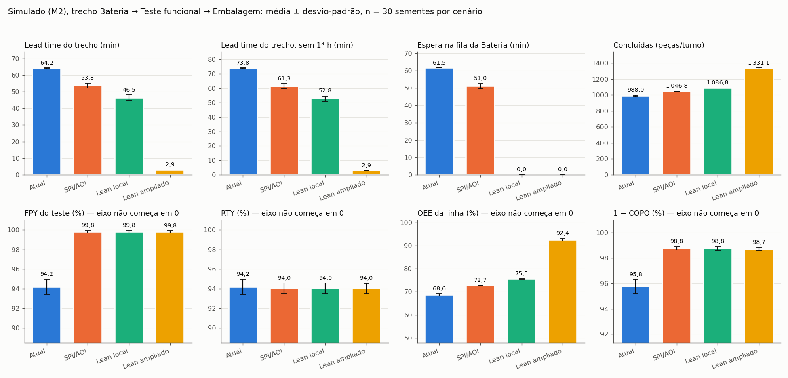

# Fase 0 — tarefa 0.8: 30 replicações do simulador do M2 no trecho (geração "Simulado")

Gerado por `f0_replicacoes.py` em 2026-11-15. Fonte: simulador do M2 (commit `1e4b27d`), turnos de 8 h, sementes 1–30 por cenário, gravação direta no SQLite (sem MQTT), um banco temporário por processo. Trecho do ADR-0009: evento `fila` no posto **Bateria** → saída da **Embalagem** (Bateria, Alto-falante, Microfone, Câmera traseira, Câmera frontal, Botões e vibra, Tampa traseira, **Teste funcional**, Embalagem). FPY, RTY, OEE da linha (ciclo ideal 20 s) e 1 − COPQ vêm do `metrics.js` do simulador em t = fim do turno; custos do painel (SPI R$ 15, AOI R$ 60, teste R$ 240, referência R$ 240). n = 30 replicações por cenário em toda célula; IC 95 % por t de Student (gl = 29, t = 2,0452).

## Tabela-resumo (média ± desvio · IC 95 % · mín–máx)

| KPI | Atual | SPI/AOI | SPI/AOI + Lean | SPI/AOI + Lean ampliado |
|---|---|---|---|---|
| Lead time do trecho, média (min) | 64,22 ± 0,22 IC [64,14; 64,30] 63,85–64,79 | 53,78 ± 1,54 IC [53,20; 54,35] 50,82–56,38 | 46,55 ± 1,60 IC [45,95; 47,14] 43,54–49,36 | 2,87 ± 0,00 IC [2,87; 2,87] 2,87–2,87 |
| Lead time do trecho, p90 (min) | 113,11 ± 0,28 IC [113,01; 113,22] 112,61–113,64 | 94,43 ± 2,82 IC [93,38; 95,49] 88,80–99,45 | 81,48 ± 2,86 IC [80,41; 82,55] 76,24–86,52 | 2,87 ± 0,00 IC [2,87; 2,87] 2,87–2,87 |
| Lead time do trecho, média, sem 1ª h (min) | 73,85 ± 0,29 IC [73,74; 73,95] 73,22–74,39 | 61,30 ± 1,84 IC [60,61; 61,99] 57,77–64,40 | 52,77 ± 1,88 IC [52,07; 53,48] 49,22–56,09 | 2,87 ± 0,00 IC [2,87; 2,87] 2,87–2,87 |
| Lead time do trecho, p90, sem 1ª h (min) | 115,01 ± 0,30 IC [114,89; 115,12] 114,42–115,70 | 95,88 ± 2,88 IC [94,80; 96,96] 90,62–101,04 | 82,69 ± 2,93 IC [81,59; 83,78] 77,33–88,03 | 2,87 ± 0,00 IC [2,87; 2,87] 2,87–2,87 |
| Espera no trecho (LT − processamento), média (min) | 61,15 ± 0,22 IC [61,07; 61,23] 60,78–61,72 | 50,71 ± 1,54 IC [50,13; 51,28] 47,75–53,31 | 43,58 ± 1,60 IC [42,99; 44,18] 40,57–46,40 | 0,00 ± 0,00 IC [0,00; 0,00] 0,00–0,00 |
| Espera média na fila da Bateria (min) | 61,54 ± 0,00 IC [61,54; 61,54] 61,54–61,54 | 51,04 ± 1,55 IC [50,45; 51,62] 48,01–53,59 | 0,00 ± 0,00 IC [0,00; 0,00] 0,00–0,00 | 0,00 ± 0,00 IC [0,00; 0,00] 0,00–0,00 |
| FPY do teste funcional (%) | 94,18 ± 0,77 IC [93,89; 94,46] 92,76–95,43 | 99,80 ± 0,13 IC [99,75; 99,85] 99,43–100,00 | 99,80 ± 0,13 IC [99,75; 99,85] 99,45–100,00 | 99,78 ± 0,12 IC [99,73; 99,83] 99,48–100,00 |
| RTY (%) | 94,18 ± 0,77 IC [93,89; 94,46] 92,76–95,43 | 94,02 ± 0,52 IC [93,83; 94,22] 93,25–95,11 | 94,03 ± 0,53 IC [93,83; 94,22] 93,23–95,12 | 94,01 ± 0,52 IC [93,81; 94,20] 93,29–95,17 |
| OEE da linha (20 s) (%) | 68,61 ± 0,56 IC [68,40; 68,82] 67,57–69,51 | 72,69 ± 0,10 IC [72,65; 72,73] 72,36–72,85 | 75,47 ± 0,10 IC [75,44; 75,51] 75,21–75,62 | 92,44 ± 0,54 IC [92,23; 92,64] 91,67–93,75 |
| 1 − COPQ (%) | 95,75 ± 0,56 IC [95,55; 95,96] 94,72–96,67 | 98,77 ± 0,14 IC [98,72; 98,82] 98,52–99,13 | 98,76 ± 0,14 IC [98,71; 98,82] 98,52–99,13 | 98,71 ± 0,15 IC [98,66; 98,77] 98,32–99,06 |
| Concluídas (peças) | 988,0 ± 8,0 IC [985,0; 991,0] 973,0–1 001,0 | 1 046,8 ± 1,5 IC [1 046,2; 1 047,3] 1 042,0–1 049,0 | 1 086,8 ± 1,4 IC [1 086,3; 1 087,4] 1 083,0–1 089,0 | 1 331,1 ± 7,7 IC [1 328,2; 1 334,0] 1 320,0–1 350,0 |

## Atual × Lean ampliado

Mesmas sementes nos dois cenários (o simulador sorteia os defeitos por placa da mesma forma em todos os cenários), por isso o teste principal é o t **pareado** por semente; o de Welch vai junto por robustez. Distinguível = IC 95 % da diferença não contém zero (equivale a p < 0,05 no pareado).

| KPI | Diferença média (Lean ampliado − Atual) | IC 95 % da diferença | p (t pareado) | p (Welch) | Distinguível? |
|---|---:|---|---:|---:|---|
| Lead time do trecho, média (min) | -61,35 | [-61,43; -61,27] | < 1e-15 | < 1e-15 | sim |
| Lead time do trecho, p90 (min) | -110,25 | [-110,35; -110,14] | < 1e-15 | < 1e-15 | sim |
| Lead time do trecho, média, sem 1ª h (min) | -70,98 | [-71,09; -70,87] | < 1e-15 | < 1e-15 | sim |
| Lead time do trecho, p90, sem 1ª h (min) | -112,14 | [-112,25; -112,03] | < 1e-15 | < 1e-15 | sim |
| Espera no trecho (LT − processamento), média (min) | -61,15 | [-61,23; -61,07] | < 1e-15 | < 1e-15 | sim |
| Espera média na fila da Bateria (min) | -61,54 | [-61,54; -61,54] | < 1e-15 | — | sim |
| FPY do teste funcional (%) | 5,60 | [5,31; 5,89] | < 1e-15 | < 1e-15 | sim |
| RTY (%) | -0,17 | [-0,34; -0,01] | 4,22e-02 | 3,14e-01 | sim |
| OEE da linha (20 s) (%) | 23,83 | [23,71; 23,94] | < 1e-15 | < 1e-15 | sim |
| 1 − COPQ (%) | 2,96 | [2,78; 3,14] | < 1e-15 | < 1e-15 | sim |
| Concluídas (peças) | 343,1 | [341,4; 344,8] | < 1e-15 | < 1e-15 | sim |

## Notas de método

- Lead time do trecho só das peças que saíram da Embalagem dentro do turno (peças ainda em fila ou em processo no fim do turno ficam de fora: censura à direita, que *subestima* o lead time quando a fila cresce, como no Atual). p90 por `statistics.quantiles(n=10, method='inclusive')`.
- Sem 1ª h (warm-up, aula M2.A2): mantém só as peças cuja entrada na fila da Bateria ocorreu em t ≥ 3 600 s.
- Espera na fila da Bateria: média de (entrada − fila) das peças que entraram no posto, a mesma definição de `lean_analysis.summarize_flow`; peças que ainda estavam na fila no fim do turno não entram (também censura).
- Espera no trecho = lead time do trecho − soma dos tempos de processamento nas estações do trecho.
- Baseline do M1 (SPECS §2.1): FPY 78 %, RTY 82 %, OEE 68 %, 1 − COPQ 95 %. Lead time e espera: sem baseline no M1.

Tempo de execução desta geração: 84.9 s no total, incluindo clone e venv da cópia (65.6 s simulando 120 turnos em paralelo com --jobs 12; 17.0 s de análise). CSV com uma linha por cenário × semente: `f0_replicacoes.csv`.
Reanálise dos mesmos bancos (`--so-analise`, só para refazer o PNG com o aviso de eixo truncado): 17,3 s; CSV idêntico byte a byte.
