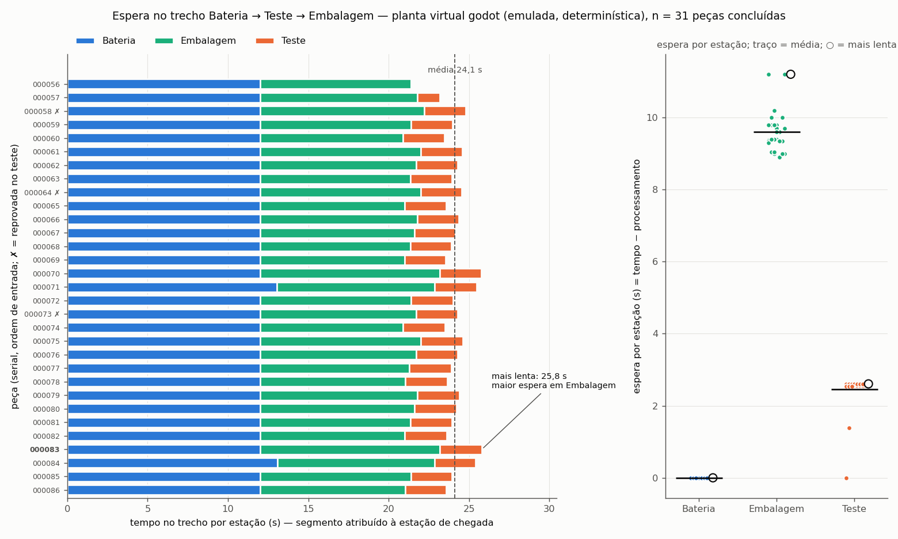

# Tarefa 2.9 — espera por peça e por estação (gerado por `f2_espera.py`)

Banco: `dados.f2.db` (aberto só para leitura por `app/nucleo/dados.py`). Origens da amostra: `emulador:godot`. **Planta virtual emulada e determinística** (ADR-0002, ADR-0013 item 5): os números servem para fluxo, rastreio e lead time do trecho de demonstração, não são medição física nem amostra de tempo de ciclo.

Peças no banco por situação: aberta 1, concluida 31. Amostra = 31 concluídas.

## Resumo do trecho

| Grandeza (n = 31) | Média | Desvio | Mín. | Mediana | Máx. |
|---|---:|---:|---:|---:|---:|
| Lead time (s) | 24,131 | 0,839 | 21,377 | 24,004 | 25,805 |
| Processamento Σ dur_s (s) | 12,069 | 0,264 | 11,998 | — | 13,067 |
| Espera = LT − processamento (s) | 12,063 | 0,768 | 9,379 | 12,005 | 13,805 |
| Espera / lead time | 50,0 % | | | | |

## Espera por estação (média das concluídas, `Dados.espera_por_estacao`)

| Estação | Espera média (s) | Desvio (s) | Mín. | Máx. | Peças em que é a maior espera |
|---|---:|---:|---:|---:|---:|
| Bateria | 0,001 | 0,001 | -0,001 | 0,003 | 0 |
| Embalagem | 9,602 | 0,558 | 8,898 | 11,199 | 31 |
| Teste | 2,542 | 0,506 | 0,000 | 2,609 | 0 |

## Peça mais lenta e onde esperou

Mais lenta: **`PC3280-2026-000083`**, lead time 25,805 s (1,673 s, 6,9 % sobre a média; 1,99 desvios). Processamento 12,000 s, espera 13,805 s. Mais rápida: `PC3280-2026-000056`, 21,377 s.

| Estação | Tempo da mais lenta (s) | Espera da mais lenta (s) | Espera média da estação (s) | Diferença (s) |
|---|---:|---:|---:|---:|
| Bateria | 11,999 | -0,001 | 0,001 | -0,002 |
| Embalagem | 11,199 | 11,199 | 9,602 | 1,597 |
| Teste | 2,607 | 2,607 | 2,542 | 0,065 |

Maior espera absoluta da mais lenta: **Embalagem**. Estação em que ela mais se afastou da média: **Embalagem** (1,597 s de 1,673 s de excesso).

Ficha da mais lenta (`Dados.ficha`, a mesma da página Rastreio; comparação: na média (±10 %), base medidas, n = 31):

| ts (UTC, gateway) | Estação | Evento | Valor | Origem |
|---|---|---|---:|---|
| 2026-11-16T21:27:05.637+00:00 | Bateria | entrada | — | `emulador:godot` |
| 2026-11-16T21:27:05.640+00:00 | Bateria | inicio | — | `emulador:godot` |
| 2026-11-16T21:27:17.637+00:00 | Bateria | fim | 12,000 | `emulador:godot` |
| 2026-11-16T21:27:20.243+00:00 | Teste | teste | 1,000 | `emulador:godot` |
| 2026-11-16T21:27:31.442+00:00 | Embalagem | saida | — | `emulador:godot` |

## Comparação com o Simulado (M2), trecho Bateria → Embalagem (tarefa 0.8)

| Geração | Fonte | n | Lead time do trecho | Espera no trecho | Espera / LT |
|---|---|---:|---:|---:|---:|
| Simulado (M2), Atual | simulador do M2, 30 sementes | 30 | 3 853,1 ± 13,0 s (64,22 min) | 3 669,1 ± 13,0 s | 95,2 % |
| Simulado (M2), SPI/AOI + Lean ampliado | simulador do M2, 30 sementes | 30 | 172,0 ± 0,0 s (2,87 min) | 0,0 ± 0,0 s | 0,0 % |
| Planta virtual (M3) | `emulador:godot`, determinística | 31 | 24,1 ± 0,8 s | 12,1 ± 0,8 s | 50,0 % |
| Baseline / meta (M1) | SPECS §2.1 | — | sem baseline no M1 | sem baseline no M1 | — |
