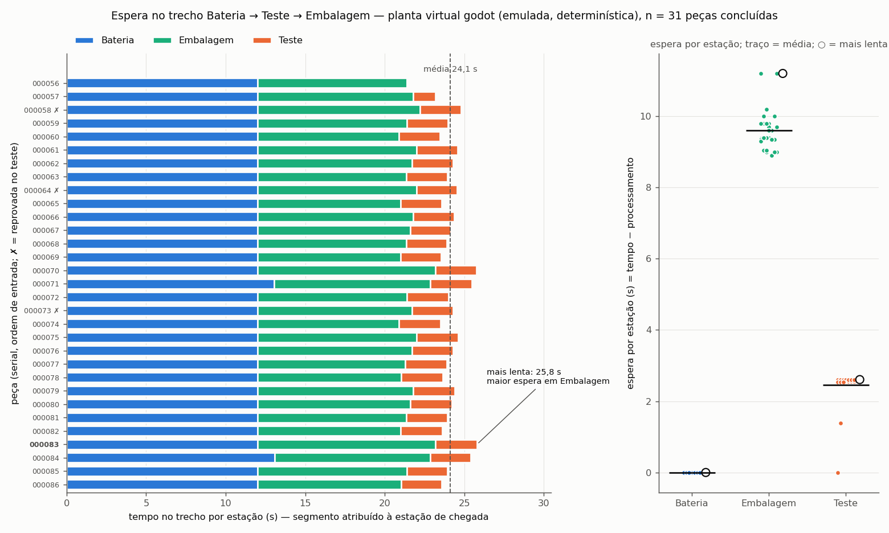

# Análise de espera do trecho (tarefa 2.9, RF-A2-08)

Data: 2026-11-16. Números gerados por [`f2_espera.py`](f2_espera.py) a partir do banco da tarefa 2.8
(`dados/dados.f2.db`, fora do Git; amostra versionada em `dados/amostras/f2-2.8-eventos-godot.csv`). As tabelas
completas estão em [`f2_espera.md`](f2_espera.md), o gráfico em [`f2_espera.png`](f2_espera.png) e uma linha por
peça em [`f2_espera.csv`](f2_espera.csv). O script lê o banco só por `app/nucleo/dados.py`, sem SQL próprio.

> **Tudo aqui é emulado.** A fonte é a planta virtual `godot` da base (origem `emulador:godot`, ADR-0002). Ela é
> **determinística** (ADR-0013 item 5): libera uma peça a cada 12 s e não tem pessoas. Toda a variação abaixo vem
> da lógica e do relógio da planta, do MQTT e do gateway, e não de operadoras, material ou método. Os números servem
> para mostrar que o rastreio localiza a espera. Não são medição física nem amostra de tempo de ciclo.

> **Acréscimo da revisão de contratos da Fase 2 (2026-11-16, achado 1).** A partição da espera **por estação**
> mudou: o ciclo associado (`inicio` → `fim`) agora é descontado na Bateria mesmo quando o `teste` chega antes do
> `fim` (caso da `000056`). Saídas regeneradas com o mesmo comando e o mesmo banco: Bateria 0,028 → **0,001 s**,
> Teste 2,820 → **2,542 s** (média sobre 30 peças: na `000056` o teste caiu dentro do ciclo), Embalagem 9,602 s
> (igual, agora a maior espera em **31 de 31** peças). Lead time, processamento e espera da peça **não mudaram**.
> As frases abaixo que citam 0,028 s, 2,820 s, "Teste em 1 (a `000056`)" e a linha da `000056` no §5 são da versão
> anterior; a tabela gerada [`f2_espera.md`](f2_espera.md) já traz os números corrigidos. Evidência:
> `docs/evidencias/f2-revisao.md`.

## 1. O que o trecho mostra (n = 31 peças concluídas)

| Grandeza | Valor | Fonte |
| --- | --- | --- |
| Lead time do trecho (entrada → saída) | 24,131 ± 0,839 s (21,377 a 25,805 s) | `emulador:godot`, n = 31 |
| Processamento (Σ `dur_s` do posto Bateria) | 12,069 ± 0,264 s | idem |
| Espera = lead time − processamento | 12,063 ± 0,768 s, **50,0 %** do lead time | idem |
| Espera média por estação | Bateria 0,028 s · Teste 2,820 s · **Embalagem 9,602 s** | `Dados.espera_por_estacao` |
| Estação com a maior espera da peça | Embalagem em 30 de 31 peças; Teste em 1 (a `000056`, ver §5) | `f2_espera.csv` |

Quase não há espera **antes** do posto Bateria (0,028 s). Na planta, a liberação a cada 12 s e o ciclo do posto
(também 12 s) estão balanceados, então não se forma fila nem WIP na entrada. A espera fica nos trechos sem
processamento instrumentado. O maior deles vai da inspeção (`teste`) até a separação (`saida`), atribuído à
Embalagem e com cerca de 9,6 s por peça.

## 2. Peça mais lenta e onde esperou

A peça mais lenta é **`PC3280-2026-000083`**:

- lead time de 25,805 s, ou seja, +1,673 s (+6,9 %) sobre a média, a 1,99 desvio da média;
- processamento de 12,000 s e espera de 13,805 s.

| Estação | Tempo da peça (s) | Espera da peça (s) | Espera média da estação (s) | Diferença (s) |
| --- | ---: | ---: | ---: | ---: |
| Bateria | 11,999 | −0,001 | 0,028 | −0,028 |
| Teste | 2,607 | 2,607 | 2,820 | −0,213 |
| **Embalagem** | 11,199 | **11,199** | 9,602 | **+1,597** |

Ela esperou na **Embalagem**, entre o resultado do teste (21:27:20,243) e a saída (21:27:31,442). Desse trecho
vêm 1,597 s dos 1,673 s de excesso (95 %).

**Ficha** (`Dados.ficha`, a mesma da página Rastreio; print `docs/evidencias/f2-2.8-rastreio-lenta.png`; shell AAS
`urn:lean-manufacture:grupo7:aas:peca:PC3280-2026-000083`, conferido na 2.8):

| ts (UTC, gateway) | Estação | Evento | Valor | Origem |
| --- | --- | --- | ---: | --- |
| 2026-11-16T21:27:05.637 | Bateria | entrada | — | `emulador:godot` |
| 2026-11-16T21:27:05.640 | Bateria | inicio | — | `emulador:godot` |
| 2026-11-16T21:27:17.637 | Bateria | fim | 12,000 | `emulador:godot` |
| 2026-11-16T21:27:20.243 | Teste | teste | 1 (aprovada) | `emulador:godot` |
| 2026-11-16T21:27:31.442 | Embalagem | saida | — | `emulador:godot` |

Comparação da página: "na média (±10 %)", com base nas medidas e n = 31. A peça mais rápida é a
`PC3280-2026-000056`, com 21,377 s.

**Por que ela foi mais lenta?** Não há causa de processo para atribuir. A planta é determinística, e o trajeto entre
a inspeção e a separação tem a mesma geometria para toda peça. A diferença de 1,6 s no segmento da Embalagem é do
mesmo tamanho do espalhamento desse segmento em todas as peças (8,898 a 11,199 s). A `000070` (25,7 s) tem quase o
mesmo excesso, na mesma estação. O excesso é compatível com ruído da emulação: o laço de 60 fps do Godot headless,
o atraso do MQTT entre dois eventos de PLCs diferentes (`plc01/part_inspected` → `part_sorted`) e o carimbo no
gateway. Por isso o excesso fica classificado como **variação da emulação, não Muda real**, no mesmo critério da
tarefa 1.13.

## 3. Ligação com uma Muda do M1

A espera localizada está no trecho **inspeção → separação/embalagem**. Ali a peça só se desloca e aguarda, sem
processamento instrumentado. Esse tempo sem valor agregado corresponde a duas Mudas apontadas no M1 (TIM WOODS,
slide 6 de `PPGEE_Grupo_7_Cen_8.pptx`; SPECS §2.1, desperdícios priorizados "espera e movimentação"):

- **W — Espera:** "o desbalanceamento deixa operadoras ociosas à espera das etapas adjacentes";
- **T — Transporte:** "placas defeituosas percorrem a linha em vez de serem retidas na origem". As 3 peças
  reprovadas no teste (`000058`, `000064`, `000073`) fazem o mesmo trajeto até a separação, com lead time de 24,3 a
  24,8 s.

A causa-raiz do M1 ligada à espera é o **Meio ambiente** do Ishikawa/5 Porquês (slide 13): "gargalos e acúmulo de
WIP entre as estações", fluxo empurrado sem limite de WIP. É aqui que a planta virtual **não reproduz** o M1. Como
ela está balanceada (12 s × 12 s), não há fila nem WIP: a espera antes da Bateria é de 0,028 s. A espera que
aparece no M3 é **transporte/espera estrutural do layout**, não acúmulo por fluxo empurrado.

O mecanismo do M1 aparece na geração Simulado (M2). No cenário Atual, a espera média na fila da Bateria é de
61,54 min, e a espera é 95,2 % do lead time do trecho (§4). Ela some no cenário com Lean ampliado.

**Conclusão (RF-A2-08).** O instrumento do M3 localiza a espera por peça e por estação: a mais lenta é a `000083`,
que esperou na Embalagem, o que corresponde à Muda Espera/Transporte do M1. Isso está comprovado por
`f2_espera.md` e pela ficha acima. A planta virtual determinística não gera a Muda de WIP por fluxo empurrado que
o M1 diagnosticou. Para observá-la com dado do M3, é preciso uma fonte com variação humana (`operador`).

## 4. Lead time do trecho × Simulado (M2)

A Fase 0 tem o número (tarefa 0.8, `f0_replicacoes.csv`, 30 sementes por cenário):

| Geração | Fonte | n | Lead time do trecho | Espera no trecho | Espera / LT |
| --- | --- | ---: | ---: | ---: | ---: |
| Baseline (M1) | SPECS §2.1 | — | sem baseline no M1 | sem baseline no M1 | — |
| Simulado (M2), Atual | simulador do M2 | 30 | 64,22 ± 0,22 min (3 853 s) | 61,15 ± 0,22 min | 95,2 % |
| Simulado (M2), SPI/AOI + Lean ampliado | simulador do M2 | 30 | 2,87 ± 0,00 min (172 s) | 0,00 min | 0,0 % |
| Planta virtual (M3) | `emulador:godot` | 31 | 24,1 ± 0,8 s | 12,1 ± 0,8 s | 50,0 % |
| Meta (M1) | SPECS §2.1 | — | sem meta no M1 | sem meta no M1 | — |

**Os valores absolutos não são comparáveis**, e isso é uma divergência de recorte, não um resultado:

- O trecho do M2 (ADR-0009) vai do evento `fila` na Bateria até a saída da Embalagem e passa por **9 estações**
  (Bateria, Alto-falante, Microfone, Câmera traseira, Câmera frontal, Botões e vibra, Tampa traseira, Teste
  funcional, Embalagem). O processamento soma cerca de 3,1 min.
- No M3, a planta `godot` instrumenta **3 pontos** (Bateria, Teste, Embalagem). O ciclo é de 12 s e não há fila
  na entrada.
- Comparar 24 s com 64 min diria só que as plantas são diferentes.

O que se compara é a **estrutura**, ou seja, onde está a espera e quanto ela pesa no lead time:

- no Atual do M2, a espera é 95 % do lead time e fica concentrada na **fila da Bateria**, com WIP por fluxo
  empurrado;
- no M3/godot, a espera é 50 % e fica no **trajeto inspeção → separação**, por transporte do layout e sem WIP.

A comparação de valor no mesmo trecho fica **pendente**. Ela precisa de um destes dois caminhos:

- coleta `operador` com o trecho completo;
- recorte do simulado do M2 aos mesmos 3 pontos.

## 5. Limitações

| Limitação | Impacto no resultado | Proposta |
| --- | --- | --- |
| Planta `godot` determinística: liberação e ciclo fixos em 12 s, sem pessoas | O espalhamento do lead time (σ = 0,84 s) é ruído da emulação. A "mais lenta" fica só +6,9 % acima da média, e a página a classifica como "na média". Não há causa de processo para a espera dela | Repetir a análise com a fonte `operador` (variação humana) ou com um roteiro com fila declarada, que não vale como medição |
| "Espera" = tempo sem `dur_s` instrumentado. Só o posto Bateria tem botão de ciclo | Os 9,6 s da Embalagem misturam transporte, inspeção e separação da planta com espera propriamente dita: é um limite superior da espera | Instrumentar ciclo no Teste e na Embalagem (`dur_s`), o que só exige configuração (RF-A2-02) |
| Ciclo da `godot` = intervalo entre liberações (convenções §5). Na `000056`, o `teste` chegou antes do `fim` | A partição por estação dessa peça fica errada: Bateria 0,83 s, Teste 11,17 s, e o processamento não é descontado de nenhuma estação. O total (lead time e espera da peça) continua certo. É a única peça com a maior espera "no Teste" | **Corrigido em 2026-11-16** (revisão da Fase 2, achado 1): o ciclo vira um segmento da Bateria; a `000056` fica com Bateria 0,001 s e Embalagem 9,378 s |
| Trecho do M3 (3 pontos) ≠ trecho do M2 (9 estações e fila) | Lead time e espera do M3 não se comparam em valor com o Simulado | Recortar o simulado aos mesmos pontos ou instrumentar o trecho do ADR-0009 |
| Lead time e espera sem baseline nem meta no M1 | Não há "atingiu?" para estes indicadores | Mantê-los como complementares (SPECS §2.1, consequência 1) |
