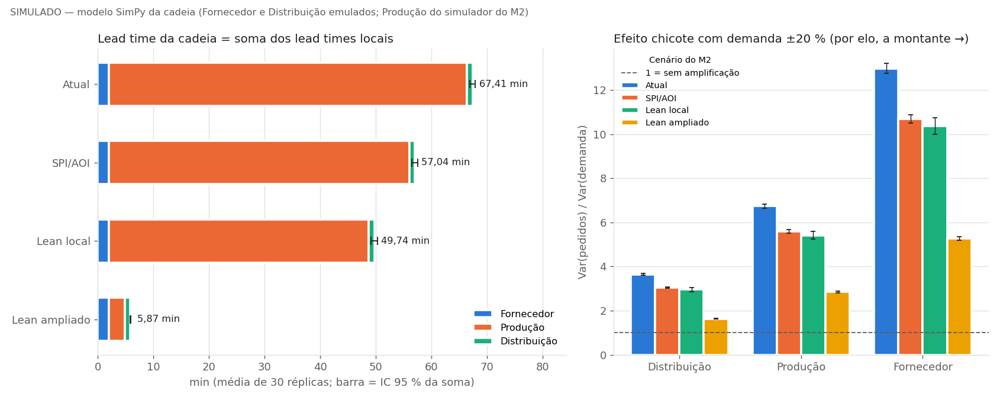

# Fase 3 — tarefa 3.0: modelo simplificado da cadeia em SimPy (geração "Simulado" do lead time da cadeia)

Gerado por `f3_cadeia_simpy.py` em 2026-11-16. **Origem de todos os números: Simulado (modelo SimPy da cadeia, parâmetros de `config/cadeia_simulacao.yaml` + `config/cadeia.yaml` → `emulados`; Produção alimentada pelo simulador do M2, `f0_replicacoes.csv`, tarefa 0.8).** Não é medição (ADR-0002, ADR-0013). Substitui o resultado da Extra 2, que o grupo não fez (P-03). Os elos Fornecedor e Distribuição não existem como parceiros (P-04): seus parâmetros são os dos elos **emulados** da 3.3, não dados de outro grupo.

n = 30 replicações por cenário (sementes 1–30, pareadas com as sementes do M2); IC 95% por t de Student (gl = 29, t = 2,0452). Células: média ± desvio · IC · mín–máx.

## Parâmetros

| Elo | Parâmetro | Valor | De onde |
|---|---|---|---|
| Fornecedor | estoque inicial / lote Q / ponto de pedido s | 100 / 50 / 20 kits | `cadeia.yaml` → `emulados` / `cadeia_simulacao.yaml` |
| Fornecedor | lead time de reposição | triangular(90; 120; 150) s, média 120 s | centro em `emulados`, variação ±25% é hipótese do modelo |
| Fornecedor | consumo | 1 kit por peça liberada | `emulados` |
| Produção | ritmo | `concluidas` do M2 da semente, liberadas em intervalo fixo no turno de 8 h | `f0_replicacoes.csv` |
| Produção | lead time por peça | lognormal com a média e o p90 do trecho da semente (média = p90 → fixo) | `f0_replicacoes.csv` |
| Distribuição | tempo de despacho | triangular(45; 60; 75) s, média 60 s | centro em `emulados`, variação é hipótese |
| Chicote | demanda / previsão / horizonte | média × (1 + U(−20%; +20%)) por período de 15 min; média móvel de 8; 400 períodos, 40 de aquecimento | `cadeia_simulacao.yaml` |

## Lead time da cadeia por cenário

| KPI | Atual | SPI/AOI | Lean local | Lean ampliado |
|---|---|---|---|---|
| Lead time local do Fornecedor, pedido → entrega (min) | 1,99 ± 0,05 IC [1,97; 2,01] 1,88–2,13 | 1,99 ± 0,05 IC [1,98; 2,01] 1,92–2,12 | 2,00 ± 0,05 IC [1,98; 2,01] 1,92–2,13 | 2,00 ± 0,04 IC [1,98; 2,02] 1,92–2,10 |
| Lead time local da Produção, trecho do M2 (min) | 64,42 ± 1,20 IC [63,97; 64,87] 62,53–66,58 | 54,05 ± 1,53 IC [53,48; 54,62] 51,15–56,40 | 46,74 ± 1,56 IC [46,16; 47,33] 43,64–49,28 | 2,87 ± 0,00 IC [2,87; 2,87] 2,87–2,87 |
| Lead time local da Distribuição, recebida → despachada (min) | 1,00 ± 0,00 IC [1,00; 1,00] 1,00–1,01 | 1,00 ± 0,00 IC [1,00; 1,00] 1,00–1,01 | 1,00 ± 0,00 IC [1,00; 1,00] 1,00–1,01 | 1,00 ± 0,00 IC [1,00; 1,00] 1,00–1,01 |
| **Lead time da cadeia = soma dos locais (min)** (RF-A3-04) | 67,41 ± 1,19 IC [66,97; 67,86] 65,54–69,54 | 57,04 ± 1,52 IC [56,48; 57,61] 54,26–59,39 | 49,74 ± 1,55 IC [49,16; 50,32] 46,77–52,31 | 5,87 ± 0,04 IC [5,85; 5,88] 5,79–5,97 |
| Lead time ponta a ponta por peça, média (min) | 65,42 ± 1,20 IC [64,97; 65,87] 63,53–67,58 | 55,05 ± 1,53 IC [54,48; 55,62] 52,15–57,41 | 47,74 ± 1,56 IC [47,16; 48,33] 44,64–50,28 | 3,87 ± 0,00 IC [3,87; 3,87] 3,86–3,87 |
| Lead time ponta a ponta por peça, p90 (min) | 114,84 ± 3,76 IC [113,43; 116,24] 109,30–123,06 | 96,29 ± 3,25 IC [95,07; 97,50] 90,38–103,37 | 83,20 ± 3,19 IC [82,01; 84,39] 77,24–89,95 | 4,01 ± 0,00 IC [4,00; 4,01] 4,00–4,02 |
| Espera por kit do Fornecedor, média (s) | 0,00 ± 0,00 IC [0,00; 0,00] 0,00–0,00 | 0,00 ± 0,00 IC [0,00; 0,00] 0,00–0,00 | 0,00 ± 0,00 IC [0,00; 0,00] 0,00–0,00 | 0,00 ± 0,00 IC [0,00; 0,00] 0,00–0,00 |
| Peças que esperaram kit (ruptura) | 0,0 ± 0,0 IC [0,0; 0,0] 0,0–0,0 | 0,0 ± 0,0 IC [0,0; 0,0] 0,0–0,0 | 0,0 ± 0,0 IC [0,0; 0,0] 0,0–0,0 | 0,0 ± 0,0 IC [0,0; 0,0] 0,0–0,0 |
| Reposições do Fornecedor no turno | 18,8 ± 0,4 IC [18,6; 18,9] 18,0–19,0 | 20,0 ± 0,0 IC [20,0; 20,0] 20,0–20,0 | 21,0 ± 0,0 IC [21,0; 21,0] 21,0–21,0 | 25,5 ± 0,5 IC [25,3; 25,7] 25,0–26,0 |
| Estoque mínimo do Fornecedor (kits) | 15,8 ± 0,4 IC [15,7; 16,0] 15,0–16,0 | 15,2 ± 0,4 IC [15,0; 15,4] 15,0–16,0 | 15,1 ± 0,3 IC [15,0; 15,2] 15,0–16,0 | 14,0 ± 0,0 IC [14,0; 14,0] 14,0–14,0 |
| Peças no turno (= concluídas do M2) | 988,0 ± 8,0 IC [985,0; 991,0] 973,0–1 001,0 | 1 046,8 ± 1,5 IC [1 046,2; 1 047,3] 1 042,0–1 049,0 | 1 086,8 ± 1,4 IC [1 086,3; 1 087,4] 1 083,0–1 089,0 | 1 331,1 ± 7,7 IC [1 328,2; 1 334,0] 1 320,0–1 350,0 |

## Atual × Lean ampliado (pareado por semente)

Mesma semente nos dois cenários (números aleatórios comuns por elo; a Produção usa a mesma semente do M2). Distinguível = IC da diferença não contém zero.

| KPI | Diferença média (Lean ampliado − Atual) | Desvio | IC 95% | Distinguível? |
|---|---:|---:|---|---|
| Lead time local do Fornecedor, pedido → entrega (min) | 0,01 | 0,02 | [-0,00; 0,01] | não |
| Lead time local da Produção, trecho do M2 (min) | -61,55 | 1,20 | [-62,00; -61,10] | sim |
| Lead time local da Distribuição, recebida → despachada (min) | -0,00 | 0,00 | [-0,00; 0,00] | não |
| **Lead time da cadeia = soma dos locais (min)** (RF-A3-04) | -61,55 | 1,20 | [-62,00; -61,10] | sim |
| Lead time ponta a ponta por peça, média (min) | -61,55 | 1,20 | [-62,00; -61,10] | sim |
| Lead time ponta a ponta por peça, p90 (min) | -110,83 | 3,77 | [-112,24; -109,43] | sim |
| Var(pedidos da Distribuição à Produção) / Var(demanda) | -2,013 | 0,082 | [-2,043; -1,983] | sim |
| Var(pedidos da Produção ao Fornecedor) / Var(demanda) | -3,892 | 0,184 | [-3,961; -3,823] | sim |
| Var(pedidos do Fornecedor à fonte) / Var(demanda) | -7,715 | 0,416 | [-7,870; -7,560] | sim |

## Efeito chicote (demanda ±20 %)

Razão = Var(pedidos do elo) / Var(demanda do cliente); > 1 = amplificação a montante. Lead time de reposição da Distribuição em períodos de 15 min (do lead time do trecho do M2): Atual = 5, SPI/AOI = 4, Lean local = 4, Lean ampliado = 1.

| Razão | Atual | SPI/AOI | Lean local | Lean ampliado |
|---|---|---|---|---|
| Var(pedidos da Distribuição à Produção) / Var(demanda) | 3,642 ± 0,107 IC [3,602; 3,682] 3,422–3,894 | 3,045 ± 0,083 IC [3,014; 3,076] 2,874–3,240 | 2,958 ± 0,232 IC [2,871; 3,045] 2,383–3,240 | 1,629 ± 0,026 IC [1,620; 1,639] 1,576–1,690 |
| Var(pedidos da Produção ao Fornecedor) / Var(demanda) | 6,738 ± 0,267 IC [6,638; 6,838] 6,204–7,458 | 5,583 ± 0,212 IC [5,503; 5,662] 5,156–6,153 | 5,416 ± 0,482 IC [5,236; 5,595] 4,220–6,153 | 2,846 ± 0,083 IC [2,815; 2,877] 2,677–3,063 |
| Var(pedidos do Fornecedor à fonte) / Var(demanda) | 12,974 ± 0,628 IC [12,740; 13,209] 11,759–14,808 | 10,688 ± 0,507 IC [10,498; 10,877] 9,705–12,160 | 10,358 ± 1,014 IC [9,980; 10,737] 7,867–12,160 | 5,259 ± 0,213 IC [5,180; 5,339] 4,839–5,862 |
| Referência analítica da Distribuição: 1 + 2k + 2k², k = (L+1)/p | 3,625 ± 0,000 IC [3,625; 3,625] 3,625–3,625 | 3,031 ± 0,000 IC [3,031; 3,031] 3,031–3,031 | 2,943 ± 0,201 IC [2,868; 3,018] 2,500–3,031 | 1,625 ± 0,000 IC [1,625; 1,625] 1,625–1,625 |

## Notas de método e limitações

- **Lead time da cadeia (RF-A3-04)** = soma dos lead times médios locais, a conta do `twin-t2t` (`Cadeia.LeadTimeCadeia`). O modelo, por ter um relógio só, mede também o ponta a ponta por peça. A soma inclui o lead time de reposição do Fornecedor, que a peça só sente quando falta kit: com estoque, a soma **superestima** o tempo que a peça leva na cadeia. Limitação → a tabela das 3 gerações (3.7) compara somas com somas → registrar as duas linhas e dizer qual é qual.
- **Produção caixa-preta:** o lead time por peça é sorteado da lognormal ajustada à média e ao p90 da semente; não reproduz a autocorrelação do M2 (no Atual a fila da Bateria cresce durante o turno). A média simulada fica próxima da média do M2 por construção (conferida no teste e na evidência).
- **Lean ampliado:** no M2 o trecho tem lead time fixo de 2,87 min (sem fila, desvio 0), por isso a Produção fica determinística nesse cenário e o desvio vem só de Fornecedor e Distribuição.
- **Sem censura:** a réplica libera as peças do turno e roda até a última ser despachada.
- **Chicote:** modelo de revisão periódica, sem capacidade, sem estoque de segurança e com pedido truncado em zero; a referência analítica vale para pedidos não truncados e demanda i.i.d. (só a Distribuição).
- **Sem baseline no M1** de lead time da cadeia (P-07): a meta e o baseline desta linha ficam em aberto.

Tempo de execução: 2,3 s para 120 réplicas (4 cenários × 30). CSV com uma linha por cenário × semente: `f3_cadeia_simpy.csv`.
