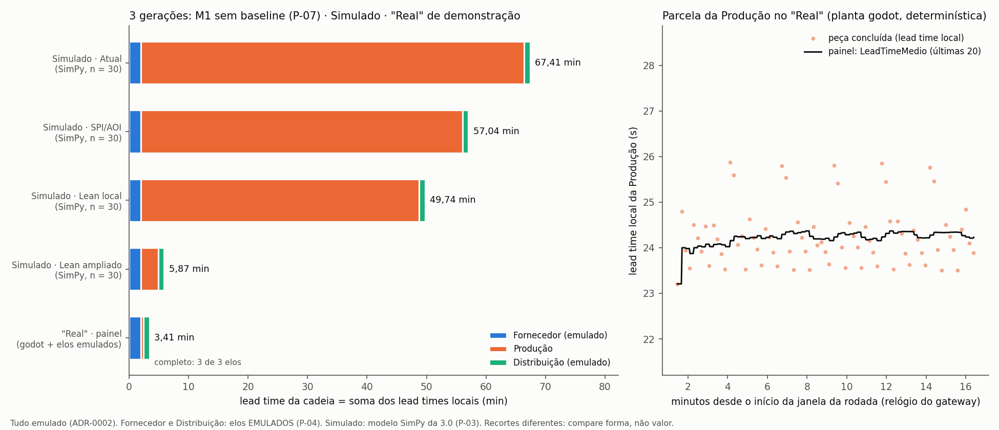

# Fase 3 — tarefa 3.7: tabela das 3 gerações do lead time da cadeia (RF-A3-06)

Gerado por `f3_tres_geracoes.py` a partir de `dados.f4.db` (somente leitura, pelo `nucleo`), `f3_cadeia_simpy.csv` (3.0) e dados/amostras/f3-3.7-elos-lead-time-2026-11-18.csv; painel gravado ao vivo em `f3_painel_cadeia.csv`.

**Tudo é emulado (ADR-0002).** A coluna "Real" é **demonstração, não medição física**: a Produção vem da planta virtual `godot` (determinística, ADR-0013 item 5) e os elos **Fornecedor e Distribuição são EMULADOS localmente** pelo Grupo 7 (P-04), com parâmetros de `config/cadeia.yaml` → `emulados`. O Simulado é o modelo SimPy da 3.0 (no lugar da Extra 2, P-03). O M1 não tem baseline nem meta de lead time da cadeia (P-07).

Janela da rodada limpa de 2026-11-18 (relógio do gateway, UTC): 2026-11-18T12:48:00+00:00 → 2026-11-18T13:04:24+00:00. O painel é lido no fim da janela, antes de qualquer parada ou falha provocada.

## Tabela das 3 gerações

Lead time da cadeia = soma dos lead times **locais** (RF-A3-04, `nucleo.estado_gemeo.lead_time_cadeia`).

| KPI | Baseline (M1) | Simulado (3.0, SimPy, média ± desvio) | "Real" (painel; demonstração) | Meta (M1) | Atingiu? |
|---|---|---|---|---|---|
| Lead time da cadeia, soma dos locais | sem baseline no M1 (P-07) | Atual: 67,41 ± 1,19 min (4 045 s; n = 30) · SPI/AOI: 57,04 ± 1,52 min (3 423 s; n = 30) · Lean local: 49,74 ± 1,55 min (2 984 s; n = 30) · Lean ampliado: 5,87 ± 0,04 min (352 s; n = 30) | **3,41 min (204,5 s)**, completo (Fornecedor, Produção, Distribuição; `LeadTimeCompleto = true`) | sem meta no M1 (P-07) | não se aplica |

### Por elo (lead time local, cada um no relógio do próprio elo)

| Elo | Quem / fonte | Simulado Atual | Simulado Lean ampliado | "Real": painel no fim da janela | "Real": amostras na janela (média ± dp; mín–máx; n) |
|---|---|---|---|---|---|
| Fornecedor | EMULADO (P-04), log do elo | 1,99 ± 0,05 min (120 s; n = 30) | 2,00 ± 0,04 min (120 s; n = 30) | 120,20 s (n = 1) | 120,20 ± 0,00 s; 120,2–120,2 s; n = 1 |
| Produção | Grupo 7, `emulador:godot` (planta determinística), `nucleo` | 64,42 ± 1,20 min (3 865 s; n = 30) | 2,87 ± 0,00 min (172 s; n = 30) | 24,23 s (últimas 20) | 24,25 ± 0,66 s; 23,2–25,9 s; n = 75 |
| Distribuição | EMULADO (P-04), log do elo | 1,00 ± 0,00 min (60 s; n = 30) | 1,00 ± 0,00 min (60 s; n = 30) | 60,10 s (últimas 20) | 60,11 ± 0,03 s; 60,1–60,2 s; n = 68 |
| **Soma** | `lead_time_cadeia` | 67,41 ± 1,19 min (4 045 s; n = 30) | 5,87 ± 0,04 min (352 s; n = 30) | **3,41 min (204,5 s)**, `LeadTimeCompleto = true` | — |

### Leitura do painel gravada ao vivo

Um observador asyncua leu o `twin-t2t` (:4851) a cada 2 s durante a janela (466 leituras; `f3_painel_cadeia.csv`). No fim da janela o painel publicava `Cadeia.LeadTimeCadeia` = **204,5 s**, `LeadTimeCompleto = true`, `ElosNoLeadTime = Producao,Fornecedor,Distribuicao`; parcelas publicadas: Fornecedor 120,2 s + Produção 24,2 s + Distribuição 60,1 s.

Primeira leitura com os 3 elos: `2026-11-18T13:03:50+00:00` (entrega da primeira reposição do Fornecedor). Leituras com `LeadTimeCompleto = true`: 17, com `LeadTimeCadeia` entre 204,5 e 204,5 s.

Conferência: a soma reconstituída pelo `nucleo` e pelos logs dos elos no fim da janela dá 204,5 s; diferença para o painel = 0,07 s (o painel e a reconstituição usam a mesma função, `lead_time_cadeia`; a diferença vem do instante de leitura).

## Origem e tamanho de cada número

| Número | Fonte | n |
|---|---|---|
| Simulado, por cenário | `dados/analises/f3_cadeia_simpy.csv` (3.0): Produção = trecho do M2 (`f0_replicacoes.csv`), Fornecedor/Distribuição = parâmetros dos elos emulados com variação triangular ±25 % | 30 sementes por cenário |
| "Real" Produção | `dados.f4.db`, tabela `eventos` (ts do gateway), peças concluídas com saída na janela; `nucleo.estado_gemeo.calcular` no instante `ate` | 75 peças (aberta: 1, concluida: 77: situação final no banco das peças que começaram na janela; aberta e incompleta = peças em trânsito nas paradas provocadas) |
| "Real" Distribuição | log do elo emulado (`despachada … após X s`, relógio do processo) | 68 despachos na janela |
| "Real" Fornecedor | log do elo emulado (`entrega de … após X s`) | 1 entregas na janela; 1 depois (falhas provocadas) |
| Baseline / Meta | SPECS §2.1 (M1) | não existe para lead time (P-07) |

## Por que divergem (recortes diferentes não se comparam em valor)

- **O que a hipótese previa (M1):** nada sobre a cadeia; o M1 não fixou lead time (P-07). O M2 previa que a fila da Bateria domina o lead time do trecho e que o Lean ampliado a elimina.
- **O que a simulação confirmou (3.0):** a soma cai de 67,41 ± 1,19 min (4 045 s; n = 30) (Atual) para 5,87 ± 0,04 min (352 s; n = 30) (Lean ampliado), e a diferença vem toda da Produção (64,42 → 2,87 min); Fornecedor (~120 s) e Distribuição (~60 s) quase não mudam.
- **O que o "Real" mostrou (rodada limpa de 2026-11-18):** 3,41 min (204,5 s), Fornecedor, Produção, Distribuição. A parcela da Produção (24,2 s) é a planta `godot`: 3 pontos de leitura, linha balanceada com takt de 12 s, sem fila. Não é o mesmo trecho nem o mesmo regime do M2 (fila de um turno de 8 h): por isso o "Real" é ~20 vezes menor que o Simulado Atual e ainda menor que o Lean ampliado. **Não** significa que a linha atingiu o Lean ampliado.
- **Por que divergiu, parcela a parcela:**
  - *Produção:* recorte diferente (trecho do M2 com 22 estações e fila × 3 pontos da planta virtual de outro produto). Só se comparam a forma da conta e a ordem de grandeza da variabilidade, não o valor (mesma limitação já registrada na 2.9 e no README §5).
  - *Distribuição:* o "Real" (60,10 s) bate com o Simulado (~60,0 s) **por construção**: os dois usam `tempo_despacho_s = 60`. A concordância confirma que o elo emulado implementa o parâmetro, não valida um processo de distribuição.
  - *Fornecedor:* no Simulado ele entra sempre na soma (média de 30 réplicas de um turno, ~19 reposições). Na rodada limpa de 2026-11-18 o estoque caiu abaixo do ponto de pedido (40) sem ser forçado e o elo entregou 1 reposição(ões) na janela: 120,2 s, igual ao parâmetro de 120 s **por construção**. Antes da primeira entrega o elo publicava −1 e ficava fora da soma, sinalizado (RF-A3-04: nunca entra como zero).
  - *Soma × ponta a ponta:* a soma inclui o lead time de reposição do Fornecedor, que uma peça só sente quando falta kit. No modelo, o ponta a ponta por peça fica ~2 min abaixo da soma (65,42 ± 1,20 min (3 925 s; n = 30) no Atual). O painel não tem ponta a ponta: exigiria comparar relógios.
- **Conclusão honesta:** a tabela comprova que o painel calcula o lead time da cadeia como soma de locais, com elo ausente sinalizado, e que o modelo dá o efeito esperado das melhorias. Ela **não** permite dizer "atingiu a meta": não há meta (P-07), a Produção "Real" é demonstração de outro recorte e dois dos três elos são emulados.

## Limitações

| Limitação | Impacto no resultado | Proposta |
|---|---|---|
| Elos Fornecedor e Distribuição emulados (P-04) | As parcelas deles repetem os parâmetros; não há processo real a jusante nem a montante | Conectar grupos parceiros (3.6, roteiro pronto) e repetir a leitura do painel |
| Produção = planta `godot` determinística, 3 pontos | Parcela da Produção ~24 s, sem fila; não comparável ao trecho do M2 | Fonte `operador` (pessoa no botão) ou roteiro com espera, e o mesmo trecho no simulado |
| Uma só reposição do Fornecedor na janela (n = 1) | A parcela do Fornecedor é uma amostra, igual ao parâmetro | Rodada de ≥ 30 min para várias reposições, ou parceiro real (P-04) |
| Sem baseline/meta de lead time no M1 | Coluna "Atingiu?" sem resposta | Grupo decide P-07 |
| O painel não guarda histórico (ADR-0028) | A série depende de um observador externo ligado durante a rodada | Manter o observador asyncua (`Cadeia.LeadTimeCadeia` em CSV) em toda rodada de evidência |

Série do painel (Produção, `LeadTimeMedio` a cada 2 s), lead time por peça e amostras dos elos: `f3_tres_geracoes.csv`.
