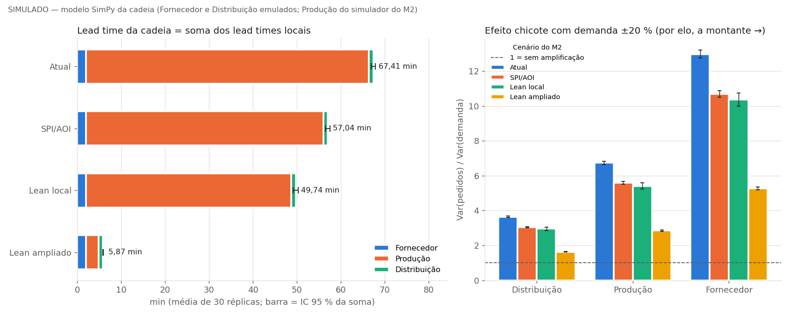

# Evidência 3.0: modelo simplificado da cadeia em SimPy (P-03, RF-A3-06, coluna "Simulado")

Data: 2026-11-16. Tarefa 3.0 do PLAN: substitui o resultado da Extra 2, que o grupo não fez (P-03).

> **Origem de todos os números desta página: Simulado (modelo SimPy da cadeia, parâmetros de
> `config/cadeia_simulacao.yaml` + `config/cadeia.yaml` → `emulados`; Produção alimentada pelo simulador do M2,
> `dados/analises/f0_replicacoes.csv`, tarefa 0.8).** Não é medição (ADR-0002, ADR-0013). Os elos Fornecedor e
> Distribuição **não são grupos parceiros** (P-04): os parâmetros deles são os dos elos **emulados** da 3.3. O M1 não
> tem baseline nem meta de lead time da cadeia: **sem baseline no M1** (P-07).

## O que foi feito

| Arquivo | Papel |
| --- | --- |
| `dados/analises/f3_cadeia_modelo.py` | Modelo SimPy: Fornecedor (`simpy.Container`, política (s, Q)) → Produção (caixa-preta do M2) → Distribuição; experimento do efeito chicote com `simpy.Store` entre os elos; estatística (IC por t) |
| `dados/analises/f3_cadeia_simpy.py` | Roda 4 cenários × 30 sementes e escreve `f3_cadeia_simpy.{md,csv,png}` (script PEP 723, mesmo padrão de `f0_replicacoes.py`/`f2_espera.py`) |
| `config/cadeia_simulacao.yaml` | Parâmetros só do modelo (ponto de pedido, variação ±25 % dos tempos, replicações, chicote). Os valores centrais (estoque 100, lote 50, reposição 120 s, despacho 60 s) **não são repetidos**: vêm de `config/cadeia.yaml` → `emulados`, os mesmos dos elos emulados da 3.3 |
| `tests/analises/test_f3_cadeia_simpy.py` | 18 testes: determinismo, conservação, lognormal, soma dos locais, ruptura, chicote × fórmula, t crítico |
| `dados/analises/f3_cadeia_simpy.md`, `.csv`, `.png` | Saídas (tabela, 120 linhas cenário × semente, gráfico) |

O `simulador/` (M2) **não foi editado nem rodado**: o modelo só lê o CSV que a tarefa 0.8 gerou. Nada foi escrito no
SQLite nem no AAS; nenhum serviço, contêiner ou porta foi usado.

### Como o modelo usa o M2

Réplica de semente *i* do modelo = linha `semente = i` do cenário em `f0_replicacoes.csv`. A Produção libera as
`concluidas` daquela semente em intervalo fixo no turno de 8 h; o lead time de cada peça é sorteado de uma lognormal
ajustada à **média e ao p90 do trecho** daquela semente (no Lean ampliado, média = p90 = 2,87 min → fixo). A réplica
roda até a última peça ser despachada (sem censura). Conferência — média do lead time da Produção (30 sementes):

| Cenário | M2 (entrada, min) | Modelo (min) |
| --- | ---: | ---: |
| Atual | 64,22 | 64,42 |
| SPI/AOI | 53,78 | 54,05 |
| SPI/AOI + Lean | 46,55 | 46,74 |
| SPI/AOI + Lean ampliado | 2,87 | 2,87 |

## Comandos e saídas reais (pasta MOD 3)

```text
$ ~/.local/bin/uv run --no-project --python 3.12 --with simpy==4.1.1 --with pyyaml --with pytest pytest tests/analises -q -p no:cacheprovider
..................                                                       [100%]
18 passed in 0.42s

$ ~/.local/bin/uv run dados/analises/f3_cadeia_simpy.py
120 réplicas em 2.3 s; saídas em .../MOD 3/dados/analises
  Atual          soma dos locais   67.41 ±  1.19 min  IC [66.97; 67.86]  | ponta a ponta   65.42 min | chicote Distribuição 3.642
  SPI/AOI        soma dos locais   57.04 ±  1.52 min  IC [56.48; 57.61]  | ponta a ponta   55.05 min | chicote Distribuição 3.045
  Lean local     soma dos locais   49.74 ±  1.55 min  IC [49.16; 50.32]  | ponta a ponta   47.74 min | chicote Distribuição 2.958
  Lean ampliado  soma dos locais    5.87 ±  0.04 min  IC [5.85; 5.88]  | ponta a ponta    3.87 min | chicote Distribuição 1.629

$ sha256sum dados/analises/f3_cadeia_simpy.csv      # duas execuções (a 2ª em outra pasta): hash idêntico
9b12ecb99c2d32c7679b35a7565dada4d0614cea62efc08f365e56468bb2f5f3

$ uvx ruff check --line-length 120 dados/analises/f3_cadeia_*.py tests/analises
All checks passed!
```

## Resultado: lead time simulado da cadeia (n = 30 por cenário, IC 95 %, t = 2,0452)

Lead time da cadeia = **soma dos lead times médios locais** (RF-A3-04, a mesma conta de `Cadeia.LeadTimeCadeia` no
`twin-t2t`).

| Cenário (M2) | Fornecedor (min) | Produção (min) | Distribuição (min) | **Soma dos locais (min)** | IC 95 % | Ponta a ponta por peça, média (min) |
| --- | ---: | ---: | ---: | ---: | --- | ---: |
| Atual | 1,99 | 64,42 | 1,00 | **67,41 ± 1,19** | [66,97; 67,86] | 65,42 |
| SPI/AOI | 1,99 | 54,05 | 1,00 | **57,04 ± 1,52** | [56,48; 57,61] | 55,05 |
| Lean local | 2,00 | 46,74 | 1,00 | **49,74 ± 1,55** | [49,16; 50,32] | 47,74 |
| Lean ampliado | 2,00 | 2,87 | 1,00 | **5,87 ± 0,04** | [5,85; 5,88] | 3,87 |

**Atual × Lean ampliado** (pareado por semente): diferença da soma = **−61,55 min**, desvio 1,20, IC 95 %
[−62,00; −61,10] → distinguível. Fornecedor e Distribuição não diferem (IC contém zero): o ganho vem todo da
Produção, como esperado num modelo em que os elos vizinhos têm os mesmos parâmetros nos dois cenários.

Fornecedor: 0 peças esperaram kit em 120 réplicas (estoque mínimo de 14 a 16 kits, nunca zerou; 18 a 26 reposições
por turno). Conservação conferida em todas as 120 linhas do CSV: estoque inicial + entregue − consumido = final, e
peças liberadas = despachadas.

## Efeito chicote (demanda ±20 %, 400 períodos de 15 min, 40 de aquecimento)

Var(pedidos do elo) / Var(demanda do cliente), média ± desvio de 30 réplicas:

| Elo (a montante →) | Atual | SPI/AOI | Lean local | Lean ampliado |
| --- | ---: | ---: | ---: | ---: |
| Distribuição → Produção | 3,642 ± 0,107 | 3,045 ± 0,083 | 2,958 ± 0,232 | 1,629 ± 0,026 |
| Produção → Fornecedor | 6,738 ± 0,267 | 5,583 ± 0,212 | 5,416 ± 0,482 | 2,846 ± 0,083 |
| Fornecedor → fonte externa | 12,974 ± 0,628 | 10,688 ± 0,507 | 10,358 ± 1,014 | 5,259 ± 0,213 |
| Referência analítica (Distribuição) 1 + 2k + 2k² | 3,625 | 3,031 | 2,943 (média) | 1,625 |

A amplificação cresce a montante em todos os cenários e cai com o lead time da Produção (L = 5 períodos no Atual,
4 no SPI/AOI e no Lean local, 1 no Lean ampliado). A razão simulada da Distribuição bate com a fórmula fechada da
política order-up-to com média móvel (diferença ≤ 0,5 %), o que valida a implementação.



Tabela completa (com mín–máx, p90, reposições, estoque mínimo e comparação pareada de todos os KPIs):
[`dados/analises/f3_cadeia_simpy.md`](../../dados/analises/f3_cadeia_simpy.md).

## Limitações (limitação → impacto → proposta)

- **Soma dos locais × ponta a ponta.** A soma inclui o lead time de reposição do Fornecedor (2 min), que a peça só
  sente quando falta kit → com estoque, a soma superestima em ~2 min o tempo que a peça passa na cadeia (67,41 ×
  65,42 min no Atual) → a 3.7 compara soma com soma (o `twin-t2t` também soma) e cita o ponta a ponta como nota.
- **Produção caixa-preta.** Lead time por peça i.i.d. da lognormal ajustada → perde a autocorrelação do M2 (no Atual
  a fila da Bateria cresce no turno) e aumenta o desvio entre réplicas (1,20 × 0,22 min no M2) → para a média da
  cadeia o efeito é pequeno (+0,2 min); se precisar da cauda, ler os lead times por peça dos bancos do M2.
- **Fornecedor e Distribuição são hipóteses.** Centro dos tempos = parâmetros dos elos emulados; a variação ±25 % e
  a política (s = 20, Q = 50) são escolha do modelo → a parte deles no lead time (3 min) não tem base empírica →
  trocar por dados do grupo parceiro quando houver (P-04, 3.6).
- **Chicote.** Revisão periódica sem capacidade, sem estoque de segurança, pedido truncado em zero e lead time
  arredondado para períodos de 15 min → serve para comparar cenários, não para dimensionar estoque → refinar com
  capacidade da linha e estoque de segurança se a Extra 3 / 5.2 for feita.
- **Sem baseline no M1** de lead time da cadeia (P-07) → a tabela das 3 gerações fica sem "Baseline" e "Meta" nessa
  linha → decisão do grupo.

## Situação diante da Definição de pronto

- Feito e verificado: modelo, 30 replicações com sementes por cenário, média ± desvio e IC, comparação Atual × Lean
  ampliado, efeito chicote ±20 %, testes de determinismo e conservação, tabela .md, .csv e .png.
- Não se aplica `start.py`: é análise offline (como as tarefas 0.8 e 2.9), não serviço. Roteiro de verificação =
  os dois comandos acima.
- Para a 3.7: coluna "Simulado" do lead time da cadeia = os valores de "Soma dos locais" acima, declarados como
  modelo.
