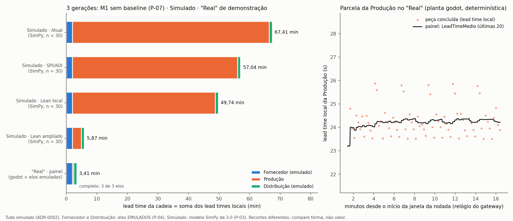
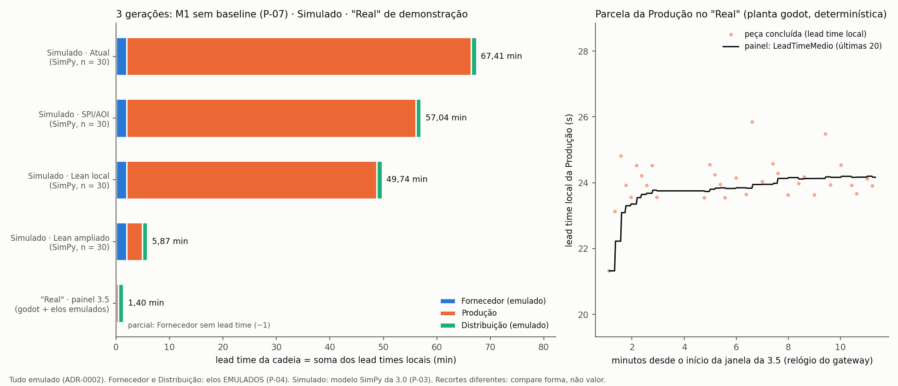

# Evidência 3.7: tabela das 3 gerações do lead time da cadeia (RF-A3-06)

Data: 2026-11-16. Tarefa 3.7 do PLAN. Convenções: `docs/convencoes-fase-3.md` §6. Skill `analise-geracoes`.

**Tudo é emulado (ADR-0002).** A coluna "Real" é **demonstração, não medição física**: a Produção é a planta
virtual `godot` (determinística, ADR-0013 item 5) e os elos **Fornecedor e Distribuição são EMULADOS localmente**
pelo Grupo 7, porque não há grupo parceiro (P-04). O "Simulado" é o modelo SimPy da tarefa 3.0 (o grupo não fez a
Extra 2, P-03). O M1 não tem baseline nem meta de lead time da cadeia: **sem baseline no M1** (P-07).

## Rodada limpa de 2026-11-18 (atual): soma com os 3 elos, lida do painel

Esta rodada substitui a de 2026-11-16 como geração "Real" da tabela. A anterior somava 2 de 3 elos e foi
reconstituída depois. Ela fica abaixo, como registro. **Continua sendo demonstração**: a Produção é a planta virtual
`godot`, determinística, e os elos são emulados. Os recortes não se comparam em valor com o Simulado.

### Como rodou

```bash
COMPOSE_PROFILES=base-completa DB_PATH=dados/dados.f4.db python3 start.py --fonte godot --manter-base   # banco novo
twin/t2t/.venv/bin/python <grava_painel.py> dados/analises/f3_painel_cadeia.csv   # observador asyncua, 2 s, só leitura
~/.local/bin/uv run dados/analises/f3_tres_geracoes.py          # lê os logs dos elos e grava a amostra
~/.local/bin/uv run dados/analises/f3_tres_geracoes.py --logs   # refaz só com a amostra salva: mesmo CSV (sha256 abaixo)
```

- **Janela:** 2026-11-18T12:48:00Z → 13:04:24Z (16,4 min), relógio do gateway.
  - Começa com a pilha subindo e o banco novo.
  - Termina antes da primeira parada provocada: a 3.5 começou às 13:04:24Z.
  - Nada foi forçado na janela. O estoque do Fornecedor caiu de 100 para 39 pelo consumo da Produção, o elo pediu às
    13:01:46Z e entregou às 13:03:47Z (`entrega de 50 após 120.2 s; estoque 80`).
- **Painel gravado ao vivo:** um observador asyncua leu o `twin-t2t` (:4851) a cada 2 s e gravou
  `dados/analises/f3_painel_cadeia.csv` (934 leituras na rodada inteira, 466 na janela).
  - Colunas gravadas: `Cadeia.LeadTimeCadeia`, `Cadeia.LeadTimeCompleto`, `ElosNoLeadTime`, `ElosForaDoLeadTime`,
    `Cadeia.Decisao`, as parcelas de cada elo (`EstadoGemeo.LeadTimeMedio`, `Cadeia.<Elo>.LeadTimeMedio`) e o
    StatusCode dos espelhos.
  - O script lê esse CSV (`--painel`). Assim a geração "Real" **é o valor publicado pelo painel**, não uma
    reconstituição.
- **Reconstituição para conferir:** o `nucleo` sobre `dados.f4.db` mais os logs dos elos dão 204,53 s. O painel
  publicou 204,46 s, uma diferença de 0,07 s que vem do instante de leitura.

Saída do script:

```text
Produção: 75 peças concluídas na janela; lead time 24,249 ± 0,663 s (23,21–25,87); painel no fim = 24,229 s (n = 20); situações: {'concluida': 77, 'aberta': 1}
Distribuição: 68 despachos na janela; painel = 60,100 s (n = 20)
Fornecedor: 1 entregas na janela; painel = 120,200; depois da janela: [120.1]
Soma do painel: 204,529 s = 3,409 min; incluídos=('Fornecedor', 'Producao', 'Distribuicao'); excluídos=(); completo=True
Painel gravado (f3_painel_cadeia.csv): 466 leituras na janela, 17 com LeadTimeCompleto = true; no fim: LeadTimeCadeia = 204,455 s, completo = True, elos = 'Producao,Fornecedor,Distribuicao', fora = ''; parcelas = {'Fornecedor': 120.177, 'Producao': 24.211, 'Distribuicao': 60.067}
Simulado Atual: soma 67,414 ± 1,193 min (n = 30)
Simulado Lean ampliado: soma 5,866 ± 0,045 min (n = 30)
```

Série do painel na transição para a soma completa (linhas do CSV, colunas resumidas):

```text
13:03:48.133Z  PRODUZINDO  LeadTimeCadeia 84,403   completo False  fora: Fornecedor:sem lead time
13:03:50.137Z  PRODUZINDO  LeadTimeCadeia 204,507  completo True   Producao,Fornecedor,Distribuicao
13:04:22.229Z  (fim da janela) LeadTimeCadeia 204,455, completo True; 17 leituras completas, todas entre 204,5 e 204,5 s
```

### Tabela das 3 gerações (atual)

| KPI | Baseline (M1) | Simulado (3.0, SimPy; média ± desvio, n = 30) | "Real" (painel, 2026-11-18; demonstração) | Meta (M1) | Atingiu? |
|---|---|---|---|---|---|
| Lead time da cadeia = soma dos lead times locais | sem baseline no M1 (P-07) | Atual 67,41 ± 1,19 min · SPI/AOI 57,04 ± 1,52 · Lean local 49,74 ± 1,55 · Lean ampliado 5,87 ± 0,04 | **3,41 min (204,5 s), completo**: 3 de 3 elos, `LeadTimeCompleto = true` | sem meta no M1 (P-07) | não se aplica |

| Elo (lead time local, relógio do próprio elo) | Simulado Atual | Simulado Lean ampliado | "Real": painel no fim da janela | "Real": amostras na janela |
|---|---|---|---|---|
| Fornecedor (**EMULADO**) | 1,99 ± 0,05 min | 2,00 ± 0,04 min | 120,18 s (1 reposição) | 120,2 s; n = 1 |
| Produção (`emulador:godot`, determinística) | 64,42 ± 1,20 min | 2,87 ± 0,00 min | 24,21 s (últimas 20) | 24,25 ± 0,66 s; 23,2–25,9 s; n = 75 peças |
| Distribuição (**EMULADA**) | 1,00 ± 0,00 min | 1,00 ± 0,00 min | 60,07 s (últimas 20) | 60,11 ± 0,03 s; n = 68 despachos |
| **Soma** | 67,41 ± 1,19 min | 5,87 ± 0,04 min | **204,46 s** (painel); 204,53 s (reconstituída) | — |



Tabela completa, origem e n de cada número, narrativa: [`dados/analises/f3_tres_geracoes.md`](../../dados/analises/f3_tres_geracoes.md).

### O que mudou na narrativa

- A soma "Real" agora tem os 3 elos: 204,5 s, cerca de **20 vezes** menor que o Simulado Atual e ainda menor que o
  Lean ampliado (352 s).
  - Isso **não** quer dizer que a linha atingiu o Lean ampliado.
  - A parcela da Produção (24 s) é a planta `godot`, com 3 pontos de leitura e sem fila.
  - O M2 é o trecho de 22 estações com a fila de um turno.
- As parcelas do Fornecedor (120,2 s) e da Distribuição (60,1 s) repetem os parâmetros dos elos emulados **por
  construção**. Elas confirmam que os elos implementam o parâmetro, não um processo real.
- **O que a tabela comprova:** o painel soma os lead times locais, publica `LeadTimeCompleto = true` quando os 3 elos
  entram e, antes da primeira reposição, deixa o Fornecedor fora da soma com sinalização, nunca como zero.
- **O que ela não comprova:** meta atingida (não há meta, P-07) nem desempenho físico.

### Reprodutibilidade e divisão do script

- `f3_tres_geracoes.csv`: sha256 `f3393f43…5c39950c`, igual na execução com os logs e na execução com `--logs` (só a
  amostra salva `dados/amostras/f3-3.7-elos-lead-time-2026-11-18.csv`).
- A rodada de 2026-11-16 continua reproduzível com os argumentos abaixo e dá o mesmo CSV de antes, sha256
  `fc5ae7c8…c94c280391`:

  ```bash
  --db dados/dados.f3.db --desde 2026-11-17T00:47:00+00:00 --ate 2026-11-17T00:58:20+00:00 --logs \
  --amostra-elos dados/amostras/f3-3.7-elos-lead-time.csv --painel "" --rodada "rodada da 3.5 (2026-11-16)"
  ```

- O script foi dividido sem mudar a saída: `f3_tres_geracoes.py` (202 linhas), `_comum.py` (140), `_grafico.py` (65)
  e `_texto.py` (≈190).

### Limitações (rodada atual)

| Limitação | Impacto | Proposta |
|---|---|---|
| Fornecedor e Distribuição emulados (P-04) | Parcelas iguais aos parâmetros | Grupos parceiros (3.6) |
| Produção = planta `godot` determinística, 3 pontos | 24 s sem fila; outro recorte que o M2 | Fonte `operador` ou roteiro com espera |
| Uma só reposição do Fornecedor na janela (n = 1) | A parcela do Fornecedor é uma amostra | Rodada ≥ 30 min para várias reposições |
| Série do painel depende de um observador externo (o twin não guarda histórico, ADR-0028) | Sem o observador ligado, volta-se à reconstituição | Manter o observador em toda rodada de evidência |
| Sem baseline/meta no M1 | "Atingiu?" não se aplica | Grupo decide P-07 |

---

## Rodada de 2026-11-16 (substituída; registro)

### Como rodou

```bash
cd "Documentation/Atividade/MOD 3"
~/.local/bin/uv run dados/analises/f3_tres_geracoes.py --db dados/dados.f3.db   # lê o banco em mode=ro pelo nucleo
~/.local/bin/uv run dados/analises/f3_tres_geracoes.py --logs                   # refaz sem os logs, da amostra salva
~/.local/bin/uvx ruff check --line-length 120 dados/analises/f3_tres_geracoes.py  # All checks passed!
```

- **Produção:** `nucleo.dados.Dados` (somente leitura) + `nucleo.estado_gemeo.calcular`, a mesma função que o
  `twin-t2t` usa para `EstadoGemeo.LeadTimeMedio`, avaliada a cada 2 s na janela da rodada da 3.5
  (2026-11-17T00:47:00Z → 00:58:20Z, relógio do gateway; fim = depois das 6 repetições oficiais, antes da primeira
  falha da 3.8). O script recusa origem `emulador:roteiro`/`teste` ou fora de `medida`.
- **Fornecedor e Distribuição:** o lead time local de cada elo é medido no relógio do próprio processo e não vai ao
  banco (ADR-0028). A fonte é o log do elo (`dados/estado/start/*.log`, fora do Git): as linhas
  `entrega de … após X s` e `despachada … após X s` são as amostras que ele publica em `LeadTimeMedio`. Extraídas
  para `dados/amostras/f3-3.7-elos-lead-time.csv` (77 amostras, versionável); a segunda execução, só com esse CSV,
  gerou a mesma tabela (`diff` sem diferença).
- **Soma:** `nucleo.estado_gemeo.lead_time_cadeia`, a função do painel. Elo sem valor fica fora e é sinalizado.
- O observador da 3.5 não gravou `Cadeia.LeadTimeCadeia` (só `ElosForaDoLeadTime = 'Fornecedor:sem lead time'`, que
  confirma a soma parcial abaixo). O valor foi reconstituído pelas mesmas funções do painel.

Saída do script:

```text
Produção: 32 peças concluídas na janela; lead time 24,030 ± 0,746 s (21,32–25,85); painel no fim = 24,166 s (n = 20); situações: {'concluida': 34, 'aberta': 9, 'incompleta': 9}
Distribuição: 36 despachos na janela; painel = 60,100 s (n = 20)
Fornecedor: 0 entregas na janela; painel = —; depois da janela: [120.2]
Soma do painel: 84,266 s = 1,404 min; incluídos=('Producao', 'Distribuicao'); excluídos=(('Fornecedor', 'sem lead time'),); completo=False
Complemento com Fornecedor (n=1, 3.8): 204,466 s = 3,408 min
Simulado Atual: soma 67,414 ± 1,193 min (n = 30)
Simulado SPI/AOI: soma 57,042 ± 1,517 min (n = 30)
Simulado Lean local: soma 49,741 ± 1,550 min (n = 30)
Simulado Lean ampliado: soma 5,866 ± 0,045 min (n = 30)
Saídas: dados/analises/f3_tres_geracoes.md, .csv, .png; amostras dos elos: dados/amostras/f3-3.7-elos-lead-time.csv
```

### Tabela das 3 gerações

| KPI | Baseline (M1) | Simulado (3.0, SimPy; média ± desvio, n = 30) | "Real" (3.5, painel; demonstração) | Meta (M1) | Atingiu? |
|---|---|---|---|---|---|
| Lead time da cadeia = soma dos lead times locais | sem baseline no M1 (P-07) | Atual 67,41 ± 1,19 min · SPI/AOI 57,04 ± 1,52 · Lean local 49,74 ± 1,55 · Lean ampliado 5,87 ± 0,04 | **1,40 min (84,3 s), parcial**: Produção + Distribuição; Fornecedor fora (sem lead time, −1) | sem meta no M1 (P-07) | não se aplica |

| Elo (lead time local, relógio do próprio elo) | Simulado Atual | Simulado Lean ampliado | "Real": painel no fim da janela | "Real": amostras na janela |
|---|---|---|---|---|
| Fornecedor (**EMULADO**) | 1,99 ± 0,05 min | 2,00 ± 0,04 min | −1 (nenhuma entrega) → fora da soma | n = 0 |
| Produção (`emulador:godot`, determinística) | 64,42 ± 1,20 min | 2,87 ± 0,00 min | 24,17 s (últimas 20) | 24,03 ± 0,75 s; 21,3–25,9 s; n = 32 peças |
| Distribuição (**EMULADA**) | 1,00 ± 0,00 min | 1,00 ± 0,00 min | 60,10 s (últimas 20) | 60,10 ± 0,00 s; n = 36 despachos |
| **Soma** | 67,41 ± 1,19 min | 5,87 ± 0,04 min | **84,3 s**, `LeadTimeCompleto = false` | — |

Complemento declarado (não é a geração "Real"): a única reposição do Fornecedor em toda a rodada foi na 3.8, com
estoque **forçado** para 5: 120,2 s (n = 1). Somada, a cadeia completa daria 204,5 s = 3,41 min.

Tabela completa, origem e n de cada número: [`dados/analises/f3_tres_geracoes.md`](../../dados/analises/f3_tres_geracoes.md).
Série do painel e amostras: `dados/analises/f3_tres_geracoes.csv`.



### Narrativa das divergências

- **Hipótese (M1/M2):** o M1 não fixou lead time; o M2 mostrou a fila da Bateria dominando o trecho.
- **Simulação (3.0):** a soma cai de 67,41 para 5,87 min do Atual ao Lean ampliado, e a diferença vem toda da
  Produção (64,42 → 2,87 min). Fornecedor (~120 s) e Distribuição (~60 s) quase não mudam.
- **"Real" (3.5):** 84,3 s, cerca de 48 vezes menos que o Simulado Atual e abaixo até do Lean ampliado. **Não** quer
  dizer que a linha chegou ao Lean ampliado: os recortes são diferentes e **não se comparam em valor**.
  - *Produção:* a planta `godot` tem 3 pontos de leitura, linha balanceada (takt 12 s) e sem fila (24 s por peça).
    O M2 é o trecho de 22 estações com fila de um turno de 8 h (64 min). Mesma limitação da 2.9 e do README §5.
  - *Distribuição:* Real 60,10 s = Simulado 60,0 s **por construção** (`tempo_despacho_s = 60` nos dois). Confirma
    que o elo emulado implementa o parâmetro, não valida um processo de distribuição.
  - *Fornecedor:* no Simulado entra sempre (turno inteiro, ~19 reposições). Na rodada da 3.5 (~11 min, ~50 peças,
    com paradas) o estoque não chegou ao ponto de pedido (40). O elo publicou −1 e ficou **fora da soma, sinalizado**
    (RF-A3-04: nunca entra como zero). A reposição forçada da 3.8 deu 120,2 s, de novo igual ao parâmetro.
  - *Soma × ponta a ponta:* a soma conta a reposição do Fornecedor, que a peça só sente quando falta kit. No modelo,
    o ponta a ponta por peça fica cerca de 2 min abaixo da soma (65,42 contra 67,41 min no Atual). O painel não tem
    ponta a ponta porque isso exigiria comparar relógios de máquinas diferentes.
- **O que a tabela comprova:** o painel calcula o lead time da cadeia como soma de lead times locais, com o elo sem
  dado sinalizado, e o modelo mostra o efeito esperado das melhorias. **O que ela não comprova:** meta atingida (não
  há meta, P-07) nem desempenho físico (Produção de demonstração, dois elos emulados).

### Atendimento

| Exigência | Situação |
| --- | --- |
| RF-A3-06: tabela das 3 gerações (meta M1 × simulado × real) **no README** | Feito: linha nova no README §5 e tabela completa em `dados/analises/f3_tres_geracoes.md` |
| Cada número com fonte e n (ADR-0013) | Feito (seção "Origem e tamanho de cada número" do `.md`) |
| Script em `dados/analises/f3_*.py` que lê pelo `nucleo` | Feito: `f3_tres_geracoes.py` (sem SQL próprio; banco em `mode=ro`) |
| Gráfico | Feito: `f3_tres_geracoes.png` (cópia acima) |
| Narrativa das divergências | Feita (acima e no `.md`) |
| Baseline/meta | Não existem no M1 (P-07): "sem baseline no M1"; "Atingiu?" = não se aplica |

### Limitações

| Limitação | Impacto | Proposta |
| --- | --- | --- |
| Fornecedor e Distribuição emulados (P-04) | Parcelas iguais aos parâmetros, sem processo real | Grupos parceiros (3.6, roteiro pronto) e nova leitura do painel |
| Produção = planta `godot` determinística, 3 pontos | 24 s sem fila, outro recorte que o M2 | Fonte `operador` ou roteiro com espera; mesmo trecho no simulado |
| Rodada curta, sem reposição do Fornecedor | Soma "Real" parcial | Rodada ≥ 30 min ou `ponto_pedido` maior só na demonstração |
| Painel sem histórico (ADR-0028) | Valor reconstituído pelo `nucleo` + logs, não print do instante | Observador da 3.5 registrar `Cadeia.LeadTimeCadeia` |
| Logs dos elos usam a hora local da máquina | Conversão para UTC supõe o mesmo fuso do computador da rodada (UTC−4) | Logs dos elos em ISO 8601 com fuso |
