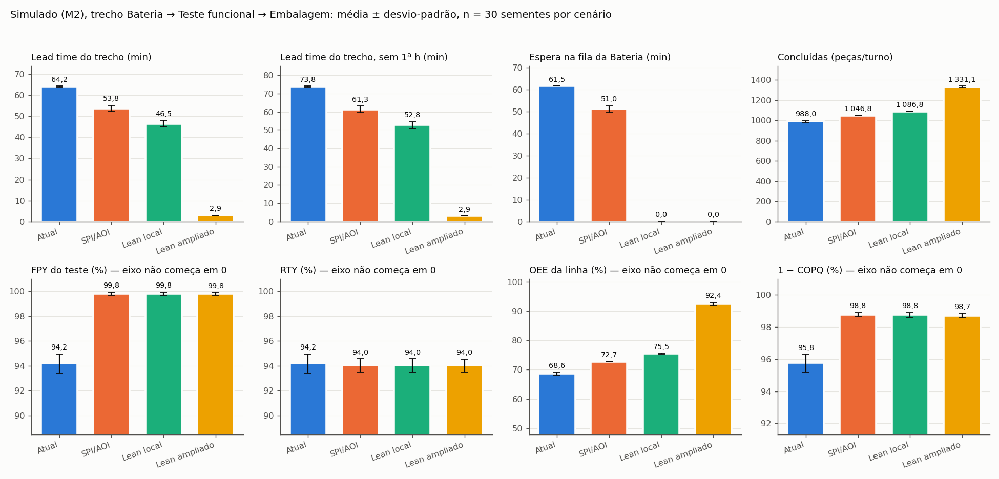
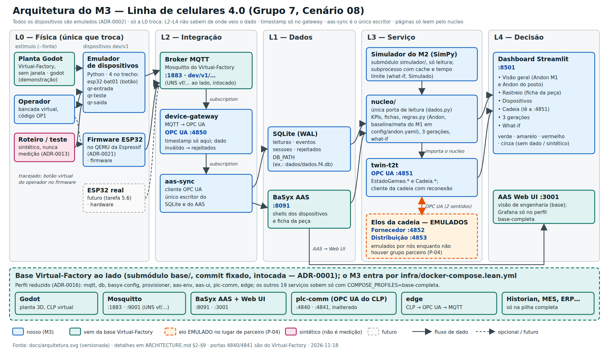
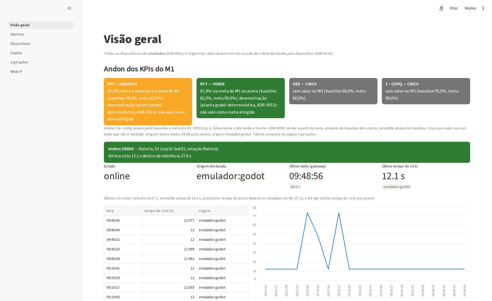
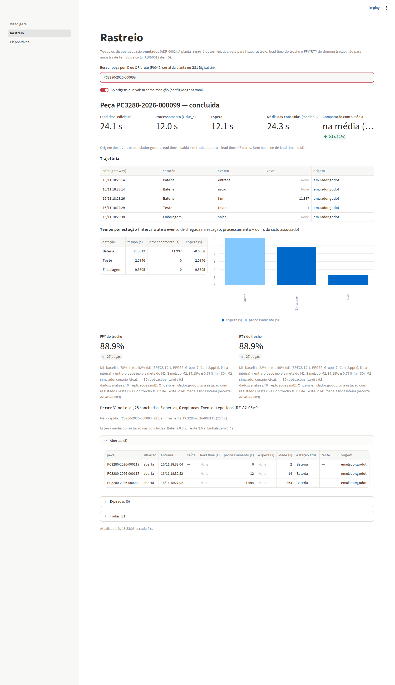
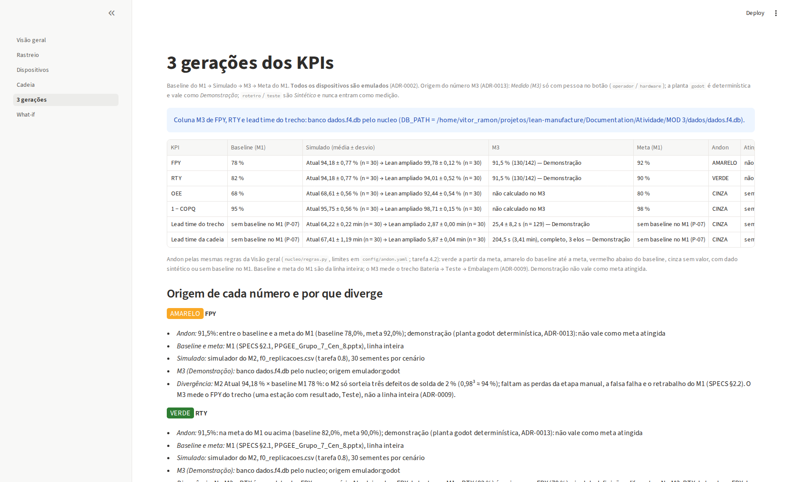
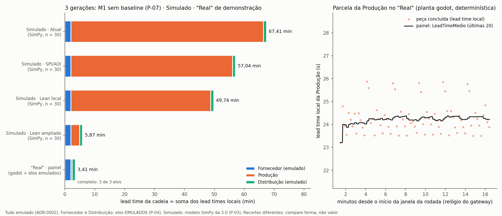
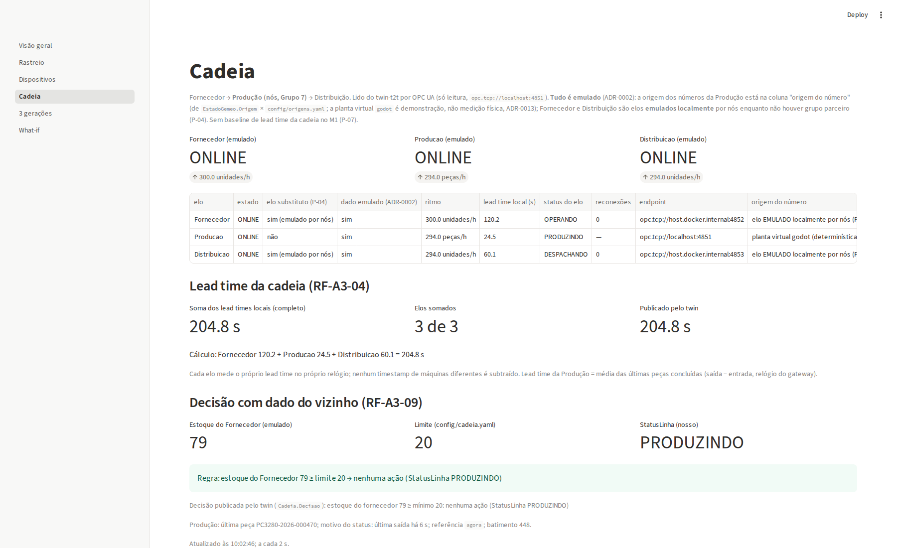
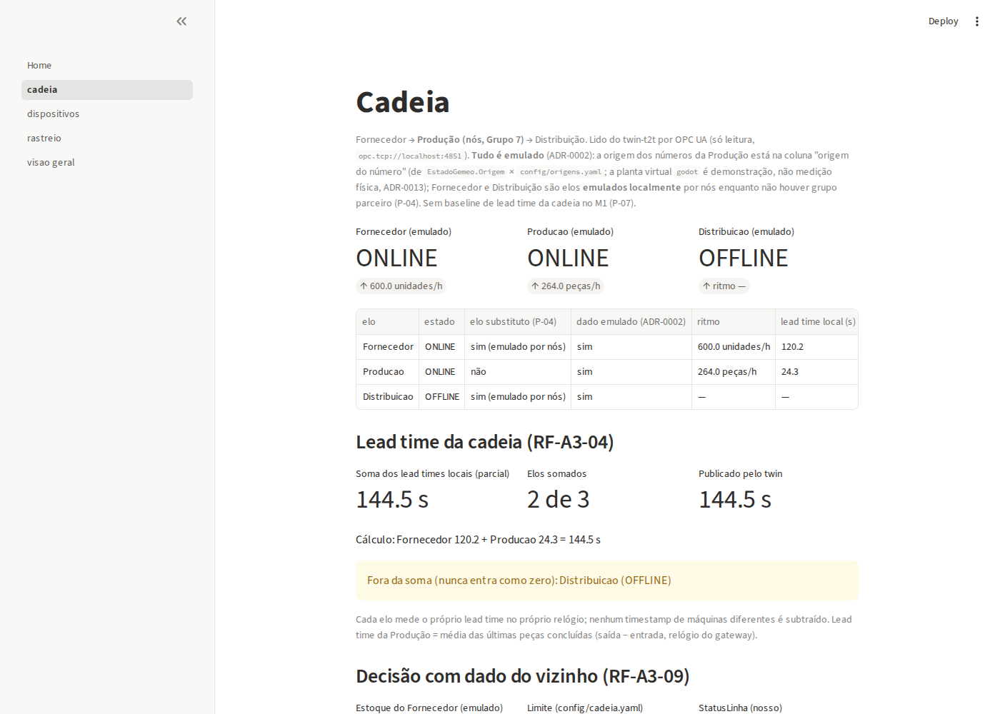

# Linha de Celulares 4.0 — Relatório final do Módulo 3

**PGENE586 — Lean Manufacturing e Qualidade Aplicadas à Indústria 4.0 (PPGEE/UFAM)**
**Grupo 7 · Cenário 08 (montagem de celulares, Polo Industrial de Manaus) · versão de 2026-11-18**

> **Declaração de origem dos dados.**
>
> - **Todos os dispositivos deste trabalho são emulados** (ADR-0002). Nenhum número deste relatório é medição física.
> - A planta virtual `godot` é determinística: vale como **demonstração**, não como medição (ADR-0013).
> - Os elos Fornecedor e Distribuição da cadeia são **EMULADOS** pelo próprio grupo, porque não houve grupo parceiro
>   (P-04).
> - Dados das fontes `roteiro` e `teste` são **sintéticos** e nunca entram como medição.
> - Cada afirmação aponta para um arquivo de `docs/evidencias/` (caminhos relativos a `docs/`) ou de `dados/analises/`.

## Sumário

1. Problema, hipótese e meta (M1)
2. Experimento simulado (M2) e método
3. Arquitetura e decisões
4. O que cada fase entregou, com evidência
5. Dispositivos, calibração e rastreabilidade
6. Três gerações dos KPIs e análise das divergências
7. Rede federada
8. Registro de falhas provocadas e recuperação
9. Outliers e comparação real × simulado
10. Limitações
11. Pendências do grupo
12. Trabalhos futuros
13. Registros de decisão (ADRs)
14. Referências

## 1. Problema, hipótese e meta (M1)

**Diagnóstico.** O M1 (`PPGEE_Grupo_7_Cen_8.pptx`, resumido em SPECS §2.1) descreveu uma linha mista. Há robôs SMT
(impressora de pasta, SPI, cinco Pick & Place, forno, AOI) e 12 operadoras no acabamento e no teste. Os achados:

- 2 % das placas têm defeito de solda, detectado só no teste final;
- cada operadora monta "do seu jeito";
- o Pareto de um lote de 10 mil dá falha de solda 116, montagem SMT 86, montagem final 25 e falsa falha 18;
- entre as causas-raiz do Ishikawa está **"sem coleta de dados em tempo real nas estações manuais" (Medida)**.

**Meta SMART do M1.** Reduzir a 0 % o avanço de placas com defeito de solda para o acabamento e padronizar o método
nas 12 estações manuais em 90 dias, sem reduzir a capacidade. Os indicadores, com baseline → meta:

| Indicador | Baseline (M1) | Meta (M1) |
|---|---:|---:|
| FPY | 78 % | 92 % |
| RTY | 82 % | 90 % |
| OEE | 68 % | 80 % |
| 1 − COPQ (scrap) | 95 % | 98 % |

O M1 não definiu baseline nem meta de lead time ou de espera. Neste relatório esses indicadores aparecem como
complementares, com "sem baseline no M1" (P-07).

**Hipótese que o M3 testa.** Se cada estação medir o próprio ciclo e cada peça for seguida por QR Code, com o
resultado do teste associado à peça, os KPIs do M1 deixam de ser estimativas de projeto e passam a ser calculados
por peça. O mesmo vale para o lead time individual. A comparação com o simulado do M2 passa a indicar onde o modelo
erra.

**Recorte (ADR-0009).** O M3 instrumenta o trecho **Bateria → Teste → Embalagem**: o gargalo do M2, o ponto de
resultado do teste e a saída. Os quatro dispositivos são:

- `esp32-bat01`: ciclo e temperatura do posto Bateria;
- `qr-entrada`, `qr-teste` (com o resultado 0/1) e `qr-saida`.

A planta 3D do Virtual-Factory produz outro produto, um cilindro pneumático. Ela é usada como gerador de fluxo, com
o mapeamento de eventos validado na tarefa 0.6 (`evidencias/f0-0.6-mapeamento.md`).

## 2. Experimento simulado (M2) e método

O simulador do M2 (`simulador/`, commit `1e4b27d`) roda em Linux sem alteração. Os 4 cenários reproduzem os números
do M2: 986, 1047, 1087 e 1327 peças concluídas, com 31 testes Python OK (`evidencias/f0-0.7-simulador-m2.md`).

O M2 tinha uma semente só. No M3 foram feitas **30 replicações de 8 h por cenário**: 120 turnos, todos validados, em
84,9 s (ADR-0017, `evidencias/f0-0.8-replicacoes.md`). Os KPIs saem do `metrics.js` do próprio M2. Resultado, com
média ± desvio e n = 30:

| KPI | Atual | SPI/AOI + Lean local | SPI/AOI + Lean ampliado |
|---|---|---|---|
| FPY | 94,18 ± 0,77 % | 99,80 ± 0,13 % | 99,78 ± 0,12 % |
| RTY | 94,18 ± 0,77 % | 94,03 ± 0,53 % | 94,01 ± 0,52 % |
| OEE (ciclo 20 s) | 68,61 ± 0,56 % | 75,47 ± 0,10 % | 92,44 ± 0,54 % |
| 1 − COPQ | 95,75 ± 0,56 % | 98,76 ± 0,14 % | 98,71 ± 0,15 % |
| Lead time do trecho | 64,22 ± 0,22 min | 46,55 ± 1,60 min | 2,87 ± 0,00 min |

Os desvios são pequenos porque o M2 fixa os tempos de processo e de chegada e sorteia só os defeitos. Eles medem a
sensibilidade à semente, não a variabilidade do processo.

A página **What-if** do dashboard roda o mesmo simulador num subprocesso, com cache e tempo limite de 60 s. As
métricas reescritas em Python reproduzem a linha da 0.8 com tolerância relativa de 1e-12
(`evidencias/f4-4.3-what-if.md`). Dois exemplos:

- Bateria a 19 s reduz o lead time do trecho em 6,80 ± 0,07 min (5 replicações).
- Defeito de 5 %, rodado pela interface com a pilha no ar, dá FPY de 85,81 %, ou −8,48 p.p. contra o Atual
  (`evidencias/f4-integracao.md`, `evidencias/f4-paginas-what-if-defeito5.png`).

## 3. Arquitetura e decisões

O caminho do dado é dispositivo → MQTT `dev/v1` → `device-gateway` (OPC UA :4850) → `aas-sync` → SQLite (WAL) e AAS
BaSyx → `nucleo` → `twin-t2t` (OPC UA :4851) e dashboard Streamlit (:8501). Três regras de camada valem em todo o
código:

- **só a L0 troca:** nada acima do broker sabe se o dado veio de emulador, firmware ou ESP32;
- **o timestamp só nasce no gateway;**
- **o `aas-sync` é o único escritor** do banco e do AAS, e as páginas só leem pelo `nucleo`, sem SQL.

A base Virtual-Factory é um submódulo mantido intocado (ADR-0001, ADR-0014). Ela fornece a planta Godot, o broker e
o BaSyx. O M3 entra por um compose adicional e pelo `start.py`, que é o comando único de subida (ADR-0012).

Decisões que mais moldaram o resultado:

- **ADR-0002:** L0 emulada, com costura para hardware real.
- **ADR-0005:** contrato `dev/v1` versionado.
- **ADR-0006:** um servidor OPC UA com um objeto por dispositivo, nas portas 4850 e 4851, porque 4840 e 4841 são do
  CLP virtual da base.
- **ADR-0013 e ADR-0025:** origem da geração Medido declarada pela L0 e configurada em `config/origens.yaml`.
- **ADR-0029 e ADR-0030:** elos emulados e espelho de elo OFFLINE com `UncertainLastUsableValue`.

A lista completa está na §13.

## 4. O que cada fase entregou, com evidência

O estado de cada tarefa está em `PROGRESS.md`. Uma tarefa só é dada como feita quando roda pelo `start.py`, tem
teste ou roteiro de verificação e tem evidência.

| Fase | Entrega comprovada | Evidência |
|---|---|---|
| 0 — Fundação | A base sobe em WSL2 a partir do submódulo com LFS: 27 serviços, assentada em 79,3 s, 2,6 GiB; perfil reduzido de 8 serviços com 776 MiB. Mapeamento planta → recorte validado | `evidencias/f0-0.3-subida-base.md`, `f0-0.5-perfil-reduzido.md`, `f0-0.6-mapeamento.md` |
| 0 — Simulado | 30 replicações × 4 cenários do M2 | `evidencias/f0-0.8-replicacoes.md` |
| 1 — Primeiro dispositivo | Contrato `dev/v1` com 104 testes; gateway OPC UA rejeita payload com data/hora e carimba o `SourceTimestamp`; rajada de 2000 mensagens em 0,82 s sem lacuna | `evidencias/f1-1.1-contrato.md`, `f1-1.3-device-gateway.md` |
| 1 — Firmware | Firmware ESP32 compilável (Flash 58,1 %) com 29 testes nativos; roda no QEMU da Espressif com 16/16 mensagens válidas | `evidencias/f1-1.7-firmware.md`, `f1-1.8-emulador-firmware.md` |
| 1 — Troca de L0 | 4 fontes (`roteiro`, `godot`, `operador`, `firmware`) pelo `start.py` com o mesmo hash de conteúdo de L2–L4 | `evidencias/f1-1.10-troca-l0.md` |
| 1 — Subida e Andon | `start.py` a frio: saudável em 59,6 s. Andon cinza 15,9 s depois do último dado (RNF-03); dashboard morto relançado em 3,4 s | `evidencias/f1-1.6-start.md`, `f1-1.5-dashboard.md` |
| 2 — Rastreabilidade | 4 dispositivos no mesmo servidor OPC UA, o 5º só por configuração; 31 peças concluídas com 157 eventos e 0 repetidos; lead time por peça 24,131 ± 0,839 s (n = 31); fichas de 4 peças no dashboard e no AAS | `evidencias/f2-2.1-dispositivos.md`, `f2-2.8-fluxo-pecas.md`, `f2-pos-revisao.md` |
| 2 — Concorrência | Carga de 2000/2000 eventos sem `database is locked` | `evidencias/f2-2.5-eventos-ficha.md` |
| 3 — Federação | `twin-t2t` na 4851; elos EMULADOS na 4852/4853; propagação em 2,42 s (n = 6); 6 tipos de falha com recuperação; lead time da cadeia 204,5 s com 3 de 3 elos | `evidencias/f3-3.1-twin-t2t.md`, `f3-3.5-propagacao.md`, `f3-3.8-falhas.md`, `f3-3.7-tres-geracoes.md` |
| 4 — Consolidação | Páginas 3 gerações, What-if e Andon dos KPIs do M1; as 6 páginas abriram pelo `start.py` sem erro, com 172 verificações OK do monitor; diagrama L0–L4 | `evidencias/f4-4.1-tres-geracoes.md`, `f4-4.2-andon.md`, `f4-4.3-what-if.md`, `f4-integracao.md`, `f4-4.5-arquitetura.md` |

## 5. Dispositivos, calibração e rastreabilidade

**Dispositivos.** O `esp32-bat01` existe como firmware real, testado byte a byte contra o contrato
(`evidencias/f1-1.7-firmware.md`). Ele roda no QEMU com a camada `hal` (ADR-0021). Pinagem prevista: botão no GPIO 5
com `INPUT_PULLUP` e DHT22 no GPIO 4. Custo estimado de R$ 90–160, sem cotação (`hardware/dispositivos.md`). Nenhuma
placa foi comprada.

**Calibração (RF-A1-06).** Os 4 testes foram feitos sobre emulação, como calibração de procedimento
(`evidencias/f1-1.11-calibracao.md`). Resultados do botão:

- offset de +0,021 s;
- erro máximo de 0,8 % num ciclo de 2 s;
- CV de 0,08 % em 10 ciclos;
- nenhum corte entre 0,25 s e 24 h.

O erro do DHT22 contra um termômetro e o repique real do botão exigem a placa.

**Rastreabilidade.** As 30 etiquetas `P0001`–`P0030` têm símbolo de 2,31 cm e foram decodificadas de volta 30/30
(`evidencias/f2-2.2-leitor-qr.md`). O gateway faz:

- normalização do QR (Digital Link, serial, `P0001`);
- deduplicação em janela de 30 s;
- expiração em 7200 s;
- associação ciclo ↔ peça (`evidencias/f2-2.3-gateway-pecas.md`).

O `aas-sync` grava `eventos(ts, peca, estacao, evento, valor)` e monta a ficha da peça no AAS. Uma ficha do AAS
dessa rodada (`WP_PC3280_2026_000102`) respondeu HTTP 200 com 14 submodels (`evidencias/f2-pos-revisao.md`). A
página Rastreio mostra por peça a trajetória, os tempos por estação, a espera e a comparação com a média.

**Análise de espera (RF-A2-08, parcial).** A peça mais lenta da rodada da Fase 2 é a `000083` (25,805 s), e a
espera dela ficou na Embalagem. A espera média por estação foi de 0,001 s na Bateria, 2,542 s no Teste e 9,602 s na
Embalagem, ligada à Muda de espera do TIM WOODS do M1 (`evidencias/f2-2.9-espera.md`). **A diferença é ruído da
planta determinística, não Muda real.** A "lenta" fica só +7 % acima da média.

## 6. Três gerações dos KPIs e análise das divergências

A tabela abaixo é a que a página **3 gerações** monta pelo `nucleo`, sem número digitado. O Simulado é recalculado
dos CSV e o M3 é lido do banco. Fonte: rodada de 2026-11-18 pelo `start.py`, `dados/dados.f4.db`
(`evidencias/f4-integracao.md`, `evidencias/f4-paginas-tres-geracoes.png`). O M3 é o do banco no instante
registrado em `f4-integracao.md` (130/142). A `f4-4.1-tres-geracoes.md` foi gerada antes, sobre o mesmo banco
(91,9 %, 125/136; lead time 25,5 ± 8,3 s, n = 124): o banco cresce enquanto a pilha roda.

| KPI | Baseline (M1) | Simulado (M2, n = 30) | M3 | Meta (M1) | Andon | Atingiu? |
|---|---|---|---|---|---|---|
| FPY | 78 % | 94,18 ± 0,77 % → 99,78 ± 0,12 % | 91,5 % (130/142), Demonstração | 92 % | amarelo | não se afirma |
| RTY | 82 % | 94,18 ± 0,77 % → 94,01 ± 0,52 % | 91,5 %, Demonstração | 90 % | verde (ressalva) | não se afirma |
| OEE | 68 % | 68,61 ± 0,56 % → 92,44 ± 0,54 % | não calculado no M3 | 80 % | cinza | — |
| 1 − COPQ | 95 % | 95,75 ± 0,56 % → 98,71 ± 0,15 % | não calculado no M3 | 98 % | cinza | — |
| Lead time do trecho | sem baseline no M1 | 64,22 ± 0,22 → 2,87 ± 0,00 min | 25,4 ± 8,2 s (n = 129), Demonstração | sem meta no M1 | cinza | não se aplica |
| Lead time da cadeia | sem baseline no M1 | 67,41 ± 1,19 → 5,87 ± 0,04 min (SimPy, 3.0) | 204,5 s, 3 de 3 elos, Demonstração | sem meta no M1 | cinza | não se aplica |

Simulado = Atual → SPI/AOI + Lean ampliado. Pela regra de origem (ADR-0013, ADR-0025, `evidencias/f4-4.1-tres-geracoes.md`):

- **Medido (M3)** só sai das fontes `operador` e `hardware`;
- a planta `godot` é **Demonstração**;
- `roteiro` e `teste` são **Sintético** e ficam cinza.

"Atingiu a meta?" só responde com Medido e por isso fica "não se afirma". No Andon, a cor da planta `godot` acende com
a ressalva "demonstração: não vale como meta atingida" (`evidencias/f4-4.2-andon.md`).

**Divergências** (documentadas, não ajustadas):

1. **FPY, M2 × M1 (94 % × 78 %).** O M2 só gera três defeitos de solda de 2 % cada, e 0,98³ = 94,1 %. Ficam fora as
   perdas da etapa manual, a falsa falha e o retrabalho que o M1 descreve. Nem o Pareto do M1 explica os 78 %: ele
   daria cerca de 97,5 % (SPECS §2.2). **Consequência:** o M2 subestima o problema de qualidade, e o ganho simulado
   de FPY (94 → 99,8 %) não pode ser comparado diretamente com a meta de 92 %.
2. **RTY, M1 incoerente com FPY.** No M1 o RTY (82 %) é maior que o FPY (78 %), o que é impossível se RTY for o
   produto dos FPY, como no M2. O M1 usou outra definição. No M3, com uma estação com resultado, RTY do trecho = FPY
   do Teste.
3. **FPY e RTY do M3 (91,5 %).** É o resultado que a própria planta virtual sorteia para o cilindro, em 142 peças. Não
   mede qualidade de solda. Fica entre o baseline e a meta, mas isso **não** é evidência de melhoria. Em outra rodada
   deu 90,3 % (28/31, `evidencias/f2-2.10-fpy-rty.md`).
4. **OEE e 1 − COPQ.** O M2 Atual coincide com o baseline do M1 (68,61 × 68 %; 95,75 × 95 %), o que dá validade
   aparente ao modelo nesses dois indicadores. O M3 não os calcula, porque o trecho instrumentado não registra
   disponibilidade, desempenho nem custo de refugo.
5. **Lead time do trecho (64 min × 25 s).** No M2 a fila da Bateria (27 s contra takt de 20 s) cresce o turno todo. A
   planta `godot` é balanceada, com takt de 12 s. São recortes diferentes e não se comparam em valor. O desvio de 8,2 s
   vem das peças das falhas provocadas (3.8) que ficaram no mesmo banco. Na rodada limpa foi 24,25 ± 0,66 s (n = 75)
   (`dados/analises/f3_tres_geracoes.md`).
6. **Lead time da cadeia (67 min × 3,4 min).** O "real" soma 120,2 s do Fornecedor emulado, 24,2 s da Produção e
   60,1 s da Distribuição emulada. Ele repete os parâmetros dos elos (120 s e 60 s), com n = 1 reposição. O SimPy
   herda a fila do M2. A diferença diz que os elos emulados são mais simples que o modelo, não que a cadeia é rápida.

## 7. Rede federada

O `twin-t2t` publica em `opc.tcp://<IP>:4851`, a partir da tabela `eventos`, as variáveis `RitmoReal`,
`RitmoProducao`, `UltimaPeca`, `LeadTimeMedio`, `StatusLinha` e `Batimento`. Elas foram lidas com `uals`/`uaread` e
conferidas por SQL (`evidencias/f3-3.1-twin-t2t.md`). O cliente da cadeia, embutido no twin, lê o Fornecedor (4852)
e a Distribuição (4853), ambos **EMULADOS**. Ele tem reconexão com backoff de 1 a 10 s e marca o elo OFFLINE pelo
`Batimento` parado (ADR-0029). O dado do vizinho entra numa decisão (RF-A3-09): estoque do Fornecedor < 20 →
`StatusLinha = RISCO_FALTA`, visto ao vivo em 3,3 s (`evidencias/f3-3.8-falhas.md`).

**Propagação (RF-A3-03).** A produção foi interrompida 6 vezes. A Distribuição reagiu (`AGUARDANDO_PRODUCAO`) em
**2,42 ± 0,47 s, máximo 3,02 s**, nas 6 dentro do alvo de 15 s, num único relógio de observador
(`evidencias/f3-3.5-propagacao.md`, `evidencias/f3-3.5-propagacao-pos-adr0030.log`). O vídeo exigido é pendência do
grupo.

**Lead time da cadeia (RF-A3-04, RF-A3-06).** É a soma dos lead times **locais**, nunca de timestamps entre máquinas.
Na rodada limpa de 16,4 min, nada foi forçado: o Fornecedor emulado entregou uma reposição, e o painel publicou
`LeadTimeCadeia = 204,5 s` com `LeadTimeCompleto = true`. Um observador gravou o painel em 934 leituras
(`evidencias/f3-3.7-tres-geracoes.md`, `dados/analises/f3_painel_cadeia.csv`).

## 8. Registro de falhas provocadas e recuperação (RF-A3-05, RF-A3-07)

Rodada de 2026-11-18 com o código atual (ADR-0030), na mesma máquina, com elos EMULADOS. Os tempos são do relógio do
observador, a partir da falha (`evidencias/f3-3.8-falhas.md`, `evidencias/f3-3.8-falhas-pos-adr0030.log`).

| O que caiu (como) | O que o sistema fez | Como voltou | Recuperação |
|---|---|---|---|
| Estoque do Fornecedor forçado a 5 (SIGUSR2) | `RISCO_FALTA` em 3,3 s, com `Cadeia.Decisao` explicando a regra | Reposição emulada de 120 s: `PRODUZINDO` em 121,7 s | automática |
| Distribuição congelada (SIGUSR1) | OFFLINE pelo `Batimento` parado em 10,5 s; espelhos `UncertainLastUsableValue`; elo fora da soma, nunca como zero | ONLINE em 1,6 s, sem reconexão | automática |
| Fornecedor parado (SIGINT) | OFFLINE em 0,9 s; `Cadeia.Decisao` = "sem decisão: estoque do fornecedor não lido" | `start.py` religou; ONLINE em 15,9 s | automática |
| Distribuição parada (SIGINT) | OFFLINE em 0,8 s | `start.py` religou; ONLINE em 7,8 s | automática |
| twin-t2t encerrado (SIGTERM) | Sem resposta em 0,3 s; Distribuição reage em 2,3 s | Docker religou: elos ONLINE em 3,7 s | automática |
| twin-t2t parado 25 s (`docker stop`) | Página "Cadeia indisponível", sem exceção | `docker start`: linha normal em 12,0 s | twin manual |
| Broker MQTT parado ~30 s (3 vezes) | `PARADA` em 39,6 s, 0,8 s e 45,0 s | Peça nova em 24,3, 17,5 e 34,8 s depois do `docker start` | broker manual |

Em todas as falhas o dashboard respondeu `/_stcore/health = ok`, e a página Cadeia renderizou sem exceção.

**Achado não resolvido.** Na queda do broker, a `PARADA` passou do limite de 30 s do RF-A3-03 em 3 de 6 quedas
(46,2 s numa rodada de 2026-11-16; 39,6 e 45,0 s nesta). A causa está confirmada pelos logs: ao parar, o broker
entrega o Last Will de só parte dos dispositivos, e o `aas-sync` fecha 2 ou 3 das 4 sessões. Quando o `qr-saida`
fica de fora, a `PARADA` só vem pela regra "sem saída há 45 s". O parâmetro não foi alterado. As 4 opções estão em
`evidencias/f3-3.8-falhas.md` e são decisão do grupo.

**Falha de integração corrigida na Fase 4.** O `start.py --parar` derrubava os contêineres, mas o `start.py` em
execução religava o dashboard e os elos. Agora o `--parar` sinaliza o processo pelo pid gravado. A correção foi
verificada ao vivo, terminando com 0 contêineres e as portas livres (`evidencias/f4-integracao.md`).

## 9. Outliers e comparação real × simulado (RF-A1-07, RF-A1-08)

**Bloqueado.** A comparação do tempo de ciclo exige ≥ 30 leituras da fonte `operador`, e a classificação de ≥ 3
outliers em Muda real × falha de medição exige dado com variabilidade humana. A planta `godot` dá ciclos entre
11,999 e 12,001 s (`evidencias/f1-1.9-fontes.md`), e o roteiro é sintético (ADR-0013). Os scripts `dados/analises/f1_comparacao.py` e `f1_outliers.py`
estão prontos e recusam amostra com menos de 30 ciclos. O roteiro de coleta é `docs/roteiro-coleta-operador.md`
(`evidencias/f1-1.12-preparo-coleta.md`). Os picos de 48 s e 73 s vistos na Visão geral
(`evidencias/f4-paginas-visao-geral.png`) são as paradas provocadas da 3.8, ou seja, falha provocada, não Muda.

## 10. Limitações

| Limitação | Impacto no resultado | Proposta |
|---|---|---|
| L0 inteiramente emulada (ADR-0002); firmware no QEMU sem Wi-Fi nem sensor físico | Nenhum KPI é medição física. O critério "sistema real" depende do aceite do professor (P-02). Ruído, repique e erro do DHT22 não foram exercitados | Placa física num posto (tarefa 5.6) e repetição da calibração |
| Sem sessão com operador (1.12 e 1.13 bloqueadas) | "Atingiu a meta?" sem resposta; sem comparação real × simulado do ciclo nem outliers | Sessão de ≥ 30 ciclos com `OP1`; scripts prontos |
| Planta virtual de outro produto, determinística | FPY de 91,5 % é sorteio da planta; peça "lenta" só +7 %; espera não é Muda real | Fonte `operador` para ficha lenta e espera |
| OEE e 1 − COPQ fora do M3 | Duas das quatro linhas do M1 sem número | Contrato para paradas e custo de refugo (ADR) |
| Trecho de 3 pontos em 22 estações; M1 é da linha inteira | Comparação de ordem de grandeza | Mais pontos de QR; comparar com o mesmo trecho do M2 |
| M2 com tempos determinísticos | Desvio do Simulado mede só a semente | Distribuição por peça (ADR-0017) |
| Elos da cadeia EMULADOS (P-04), tudo numa máquina | Propagação e contrato não provam interoperabilidade nem rede entre grupos | Parceiro real com o roteiro de `cartoes_conexao.md` §5 |
| Lead time "real" da cadeia com n = 1 reposição | 204,5 s repete parâmetros dos elos | Rodada ≥ 30 min com várias reposições |
| Queda do broker com `PARADA` em até 45 s | RF-A3-03 descumprido nesse modo de falha | Decisão do grupo entre as 4 opções da 3.8 |
| Banco reaproveitado mistura rodadas | O desvio do lead time sobe de 0,66 s para 8,2 s | Banco novo por rodada ou filtro de janela no `nucleo` |
| README não testado em máquina limpa (4.7) | Passo implícito pode faltar a um terceiro | Teste do terceiro com ata |

## 11. Pendências do grupo (declaradas)

O que o código não fecha está em `docs/pendencias-do-grupo.md`:

- **Gravar:** vídeo do dashboard (RF-A1-10), vídeo de uma peça atravessando a linha, vídeo da propagação (RF-A3-03) e
  vídeo de reserva de 3 min (RF-A4-08).
- **Capturar:** prints do UaExpert nas portas 4850 e 4851 (RF-A1-03, RF-A2-01, RF-A3-01).
- **Coletar:** sessão com operador, ≥ 30 ciclos (1.12 e 1.13).
- **Decidir:** aceitar os ADRs Propostos, P-02 (L0 emulada), P-04 (parceiros), P-05 (datas e papéis), P-07 (meta de
  lead time), a queda do broker e a borda do Andon (igual ao baseline = amarelo ou vermelho).
- **Entregar:** teste do terceiro (4.7), slides e ensaio cronometrado (4.9) e envio no ambiente da disciplina (4.11).

## 12. Trabalhos futuros

- Coleta com operador e a geração Medido completa, com Ishikawa 6M a partir dos outliers medidos (tarefa 5.1, bônus).
- Gêmeo coordenador da cadeia (Extra 3) e experimento do efeito chicote ±20 % (tarefas 5.2 e 5.2a).
- Federação ao vivo com outro grupo (5.3) e ESP32 físico substituindo um emulador (5.6).
- Detecção de broker fora no gateway (opções a e c da 3.8, com ADR) e buffer de eventos no gateway.

## 13. Registros de decisão (ADRs)

Os 33 ADRs estão em `docs/adr/`. **Aceitos pelo grupo:** 0001, 0002, 0004 e 0013 a 0018. Os demais estão
**Propostos** e aguardam o grupo.

| ADR | Decisão | Estado |
|---|---|---|
| 0001 | Virtual-Factory como base, intocado | Aceito |
| 0002 | L0 emulada com costura para hardware | Aceito |
| 0003 | Firmware ESP32 real como entregável, com lógica separada do hardware | Proposto |
| 0004 | Fluxo dispositivo → MQTT → OPC UA → AAS | Aceito |
| 0005 | Contrato MQTT `dev/v1` | Proposto |
| 0006 | Um servidor OPC UA, vários objetos; portas 4850 e 4851 | Proposto |
| 0007 | AAS para estado e ficha; SQLite para séries e eventos | Proposto |
| 0008 | Identidade de peça por QR, deduplicação e expiração | Proposto |
| 0009 | Recorte do Cenário 08 e mapeamento da planta | Proposto |
| 0010 | Dashboard Streamlit com Andon de 4 níveis | Proposto |
| 0011 | Federação T2T com elo emulado como reserva | Proposto |
| 0012 | Compose adicional e `start.py` | Proposto |
| 0013 | Medido nunca vem de roteiro; planta só para fluxo, rastreio e FPY de demonstração | Aceito |
| 0014–0018 | Submódulos e LFS; contêiner de desenvolvimento; perfil reduzido; método das 30 replicações; PlatformIO | Aceitos |
| 0019–0027 | Diagnóstico do gateway; AAS e banco; QEMU; profiles; bibliotecas; rede do contêiner; origem `teste`; resultado no `scan`; ficha no AAS | Propostos |
| 0028–0030 | Address space do twin; elos emulados e cliente; elo OFFLINE e texto da decisão | Propostos |
| 0031–0033 | What-if em subprocesso sobre o simulador do M2; limites do Andon em `config/andon.yaml` (validados, lidos sob demanda); relatório e diagrama com `markdown` + Playwright | Propostos |

## 14. Referências

- Aulas da disciplina PGENE586, módulos 1 a 3 e Extras (PPGEE/UFAM), consolidadas em `SPECS.md`.
- Grupo 7. Entrega do M1: `PPGEE_Grupo_7_Cen_8.pptx` (diagnóstico, baseline e metas).
- Grupo 7. Entrega do M2: repositório `vitorramon/GemeoDigitalCelulares`, commit `1e4b27d` (submódulo `simulador/`).
- aaronzi. *Virtual-Factory*, commit `c558b9e`, licença Apache-2.0: <https://github.com/aaronzi/Virtual-Factory>.
- Bibliotecas usadas, com versões fixadas no ADR-0023 e nos `uv.lock`: asyncua (OPC UA), paho-mqtt, Eclipse BaSyx
  (AAS), SimPy, Streamlit.
